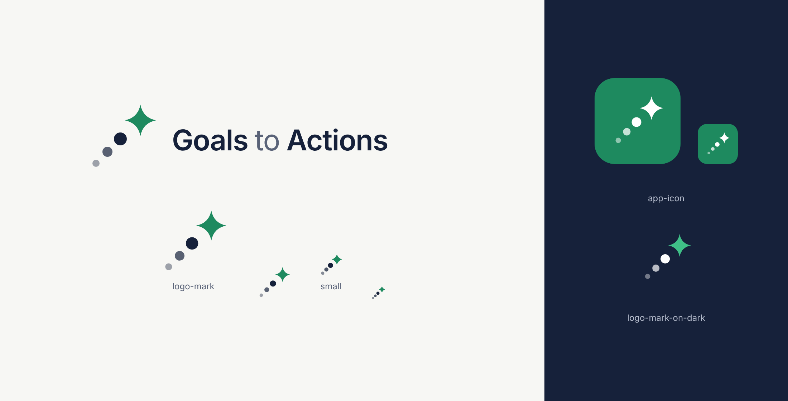

# Brand

The logo, chosen Nov 19, 2026: **stepping stones to a star.** Three dots that grow as they rise, leading to a four-pointed star: small daily actions building toward a big north-star aspiration. The full story and what's still open is in the claude.ai project (`claude/brand-and-logo.md`); the explorations are on the "Goals to Actions logo" design canvas (board E).

## Files

| File | Use |
| --- | --- |
| `logo-mark.svg` | The mark on light backgrounds, 40 px and up |
| `logo-mark-small.svg` | Favicon and anything under about 32 px: bigger dots, fatter star |
| `logo-mark-on-dark.svg` | The mark on dark backgrounds (white dots, brighter green star) |
| `app-icon.svg` | Home-screen and PWA icons: white mark on a green square. iOS rounds the corners itself, so the square has none |
| `wordmark.svg` | Mark plus "Goals to Actions". The text isn't outlined: it uses Space Grotesk where installed, else the system font. Outline it before using it outside the app |

## Colors

- Ink `#16213A` (dots at 40%, 70% and 100%), muted ink `#5A6378` ("to" in the wordmark)
- Green `#1E8A5F` (star, app icon); `#3FBF87` for the star on dark
- Buttons and accents in the app stay `#2f6f4f`: white text on `#1E8A5F` falls just short of 4.5:1

## For the app

`web-frontend/public/` still has the placeholder checkmark icons from the scaffold. Replace `icon.svg`, `icon-192.png`, `icon-512.png` and `apple-touch-icon.png` from `app-icon.svg`, and use `logo-mark-small.svg` for the favicon.

## Open

The final product name, the final typeface and exact green.
