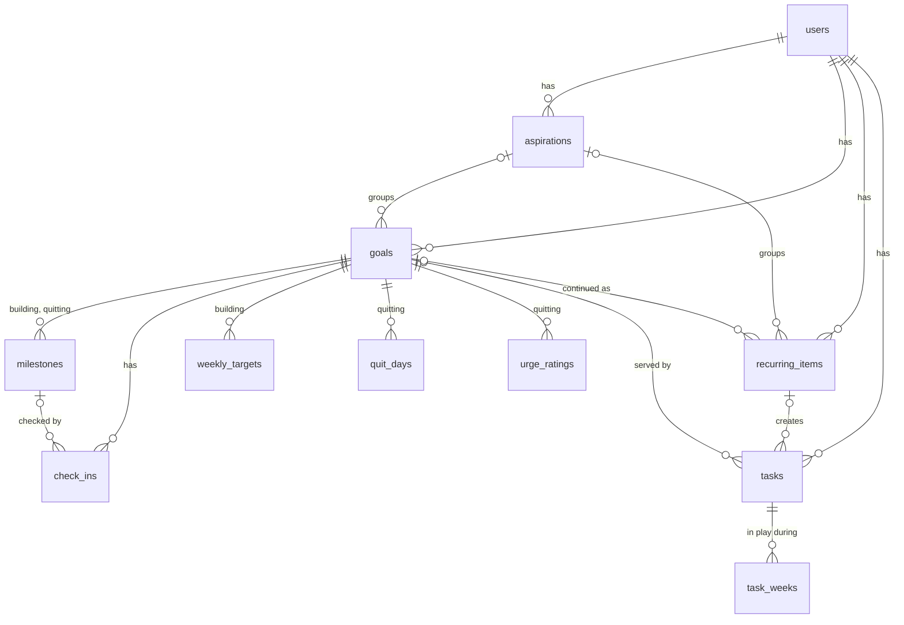

# Data model

The model the API is built on (Postgres, ADR-003). It was settled on 2026-11-13, before any API code, and the front end follows it, not the other way round. Column types, indexes and migrations are written in the API repo; this doc says what exists, what each thing means and which rules the data must keep.

Two ideas shape most of it:

- **A task is something you do; a milestone is something you reach.** There is no third concept. A one-off goal's steps are tasks.
- **A task is one row for its whole life, and each week it spends in play is its own record** (ADR-006). The plan, the bank, rollovers and the history of what happened all come from those records.

## At a glance

## On every table

| Column | Set by | Notes |
| --- | --- | --- |
| `id` | The device | A UUID made where the row is created, so something added offline keeps its id and a repeated send is harmless (ADR-004). |
| `user_id` | The server | The owner. A row can only point at rows with the same owner. |
| `created_at`, `updated_at` | The server | Moments in UTC. Phone clocks aren't trusted for ordering. |
| `deleted_at` | The server | Empty unless deleted. See [Drop and delete](#drop-and-delete). |

Three kinds of time are stored three ways, none with an offset:

- **A moment** (when a row changed, when a task was checked off) is a `timestamptz`: a UTC instant. The API sends and returns ISO 8601 ending in `Z`.
- **A day** (a planned day, a due date, a week, the day a check-off counts for) is a plain `date`. It has no zone, so it can't shift when you travel.
- **A time of day** ("at 6 p.m.") is a plain `time`: 6 p.m. wherever you are.

A **week** is named by the date of its Monday.

## Tables

### users

| Field | Notes |
| --- | --- |
| Intensity | Going hard, normal (the default) or easing off. Sets the daily task cap, and so how much free time is protected. |
| Last-known time zone | A zone name (`America/Denver`), sent by the phone with each request. Not a setting; there's nothing to change when you travel. |
| Planned through week | The latest week whose bank has been filled. The current week is this or the phone's week, whichever is later, so the week never goes backwards. |

Sign-in is undecided (ADR-003); its fields are added when it is.

### aspirations

| Field | Notes |
| --- | --- |
| Name, why | Why is optional. |
| Status | Active or retired. |
| Position | Priority among active aspirations: 1, 2, 3 with no gaps. Empty when retired; brought back, it goes last. |
| Retired on | A day, shown as "Retired Nov 10". Empty when active. |

### goals

| Field | Notes |
| --- | --- |
| Aspiration | Optional. |
| Type | Building, quitting or one-off. Picked by the person, never inferred. |
| Label, measurable line | Both text. Every goal has a line it could cross. |
| Baseline | Text, optional: "Where are you now?" |
| Status | Active, paused, reached or ended. |
| Start date | A day. For a quitting goal, the first day of its daily record. |
| Deadline | A day, optional and opt-in, never before the start date. |
| Ended on | A day, set when the goal is reached or ended, cleared by Reopen and Go again. |

What differs by type lives in the tables below, not in separate goal tables:

| Type | Has | Doesn't have |
| --- | --- | --- |
| Building | Weekly targets, milestones | Quit days |
| Quitting | Quit days, urge ratings, milestones | Weekly targets |
| One-off | Steps, which are tasks | Weekly targets, milestones |

- **Go again is the same goal.** It becomes active with its target, milestones and history as they were.
- **A passed deadline needs no extra field.** The "This one slipped" card shows while the goal is active and its deadline is in the past. Pushing the date back or ending the goal both make it go away. A goal ended this way is plainly "ended"; there's no "missed" status and no hard-deadline flag.

### milestones

Building and quitting goals only.

| Field | Notes |
| --- | --- |
| Goal | Required. |
| Position | The order they're checked in. Dates are optional, so order can't come from them. |
| Measurable line | Text. |
| Target date | A day, optional, between the goal's start and its deadline. |
| Status | Upcoming, hit or not yet. |

- **The goal is its own final milestone** and isn't stored as one: progress counts the goal's milestones plus one ("1 of 6").
- **"Passed on the way"** isn't stored: it's a milestone that isn't hit on a goal that's reached.
- Status is stored, not read off the latest check-in, because choosing keep, move or adjust after a "not yet" puts the milestone back to upcoming without a new check-in.

### check_ins

One row each time you check in, so results have a history. "Latest" on a goal's page is its most recent check-in with a result.

| Field | Notes |
| --- | --- |
| Goal | Required. |
| Milestone | Empty when the check-in is for the goal's own line. |
| Outcome | Hit or not yet. |
| Result | Text, optional. |
| Checked in on | A day. |

### weekly_targets

Building goals only. A change adds a row, so earlier weeks keep the target they had.

| Field | Notes |
| --- | --- |
| Goal | Required. |
| Kind | **Count** ("3 lifting sessions") or **amount** ("25 miles over 4 runs"). |
| Sessions | How many tasks the week gets. |
| Amount | Amount targets only: the total to reach. |
| Unit | "lifting sessions", "miles". |
| Effective from | A week. One row per goal per week: a second change in the same week replaces the first. |

- **Count progress** is the goal's tasks done this week, out of sessions.
- **Amount progress** is the sum of the values logged on the goal's tasks done this week, out of amount. The value's unit is the target's.

### recurring_items

Maintenance, or a practice kept up. Each creates tasks.

| Field | Notes |
| --- | --- |
| Name | |
| Aspiration | Optional. With none, the item belongs to Keep life running. |
| From goal | Optional: the goal whose practice this continues, set when a reached goal is kept as a recurring item. |
| Schedule kind | **Weekly on** a weekday, **monthly on** a day from the 1st to the 28th, or **flexible**. |
| Weekday, day of month | For the two fixed kinds. |
| Times, period | Flexible only: 1 to 6 times a week, once every two weeks, or once a month. |
| Starts on | The day it's first due. Also anchors a two-week period. |
| Active | One on/off state. Turned off by hand and paused by retiring its aspiration are the same state; the audit log holds which. |

- **The readable repeat ("Every Tuesday", "3 times a week") and the next due day are worked out**, not stored.
- **Not yet offered:** yearly repeats, "every N weeks" and a time of day. Each is another schedule kind or one more column.

### tasks

| Field | Notes |
| --- | --- |
| Title | |
| Origin | **By hand**, **weekly target** or **recurring item**. Decides what happens when the task isn't finished (below). |
| Goal | Optional. Required when the origin is weekly target. A one-off goal's tasks are its steps. |
| Recurring item | Set when the origin is recurring item. |
| State | Open, done, dropped or lapsed. |
| Due date | A day, optional. A real constraint, unlike the planned day. |
| Time of day | Optional: a kind ("by" or "at") and a time. Tasks without one float around the timed ones. |
| Value logged | A number, optional (miles, minutes). Counts towards an amount target. |
| Completed at, completed on | The moment the phone recorded the check-off, and the day it counts for as the phone saw it. A 12:30 a.m. check-off counts for the new day. |
| Period start, number | Generated tasks only: which week or period the task is for, and which one of that period's it is (session 2 of 3). Unique per goal or recurring item, so a week can't be filled twice. |
| Still matters answered on | A day: when "Still matter?" was last answered Keep or Reschedule. |

A task with no goal and no recurring item is a one-time life task, part of Keep life running.

### task_weeks

One row for each week a task is in play. This is the plan: there is no separate plan table.

| Field | Notes |
| --- | --- |
| Task, week | One row per task per week. |
| Planned day | A day in that week. Empty means the task is in that week's bank. |
| Placed by hand | Set when you put the task on a day yourself; cleared when it goes back to the bank. The planner never moves these. |
| Outcome | Empty while the week is in play for the task. Then **done**, **rolled over**, **lapsed**, **dropped** or **set aside**. |

What the screens show comes from these rows:

| On screen | In the data |
| --- | --- |
| A day's plan | The week's rows planned for that day, with no outcome or done. |
| The bank | This week's rows with no planned day and no outcome. |
| "Back to bank" | The planned day cleared. Nothing else changes. |
| Upcoming list | Open tasks with a later due date and no row yet. |
| A one-off goal's waiting steps | Its open tasks with no row yet. |
| Times carried over | The task's rows with the outcome rolled over. |
| Pinned to a later week | A row for that week with a planned day, placed by hand. The model allows it; the app doesn't offer it yet. |

**How a week ends for an unfinished task:**

| Task | At the end of the week |
| --- | --- |
| Weekly target | **Lapses.** Next week gets its own fresh sessions; missed ones don't pile on top. |
| Flexible recurring | **Lapses at the end of its period** (week, two weeks or month). Inside a longer period it carries from week to week. The next period's task replaces it. |
| Fixed-day recurring | **Rolls over.** Rent missed on the 1st still has to be paid. |
| By hand, steps included | **Rolls over.** |

Rolling over closes this week's row as rolled over and opens one in the next week's bank. Lapsing closes the row and the task; the miss stays in history.

**Set aside** is what happens to a goal's unfinished tasks when it's paused, or when its aspiration is retired with its work paused, including tasks placed by hand. The row keeps its planned day but no day shows it. Resuming the goal returns its open tasks to this week's bank. (The first model called this "skipped", which read like "Back to bank". It isn't.)

### quit_days

Quitting goals only. Not tasks: they never enter the bank or count against the day's cap.

| Field | Notes |
| --- | --- |
| Goal, day | One row per goal per day. |
| Held | Yes or no. |

**No row means unknown**, not a slip. A week away is a week of no answers, not seven failures. Streaks are worked out, never stored.

### urge_ratings

| Field | Notes |
| --- | --- |
| Goal, rated on | One row per goal per day. |
| Level | Low, some or strong. |

"The urge has stayed low for a while" is worked out. The app can point it out; only you mark the goal reached.

### audit_log

Written by a database trigger on every table above: one row per insert, update or delete (ADR-005).

| Field | Notes |
| --- | --- |
| Table, row id | What changed. |
| Operation | Insert, update or delete. |
| Before, after | The whole row as JSON. |
| User, action | Who, and the name of the API action ("skip task", "pause goal"), which the API sets for each transaction. |
| Changed at | A moment. |

No screen reads it. It's for recovery, debugging, and questions nobody has asked yet.

## Drop and delete

- **Drop** is "I decided not to do this": the answer No to "Still matter?". The task's state becomes dropped and it stays in history.
- **Delete** is "this was a mistake". It's offered on tasks, milestones, goals, aspirations and recurring items. The row gets a deleted time and is hidden everywhere; deleting a goal takes its tasks, milestones, check-ins and records with it. The row stays in the database so the delete reaches your other devices.

## Rules the data must keep

- Every row has an owner, and never points at another owner's row.
- Active aspirations are numbered 1 to n with no gaps; a retired one has no position.
- Milestones and weekly targets belong only to goals of a type that has them (see the table under goals).
- A task has a goal or a recurring item or neither, never both.
- A generated task is unique for its goal or recurring item, its period and its number.
- A task has at most one row per week, and at most one row with no outcome.
- A task's state and its rows agree: done, dropped and lapsed tasks have no row still in play, and a done task's last row is done.
- A planned day falls inside its row's week.
- The planner writes only to days after today, and never to a row placed by hand. This is what keeps Today from changing on its own.
- A milestone's date falls between its goal's start and deadline; a deadline is never before the start date.

## Where history lives

The rule: **if a feature reads it, it's a table or a column; everything else is in the audit log** (ADR-005).

| History | Where |
| --- | --- |
| Which weeks and days a task was on, how each week ended, how often it rolled over | `task_weeks` |
| Weekly target changes | `weekly_targets` |
| Check-in results | `check_ins` |
| Daily quitting answers, urge ratings | `quit_days`, `urge_ratings` |
| When a goal was paused and resumed, when an aspiration was retired and brought back, intensity changes, edits to names and lines | `audit_log` only |

## Designed, not built: metrics

Measurable lines, baselines and results are text, so the app can show "Started at" and "Latest" side by side but can't calculate progress. Metrics are an optional layer on top of the text that would let it. The text is always kept; a goal with no metrics works exactly as it does now. The tables aren't created until something fills them: a small "add numbers" form on the goal's page, or a feature that reads the numbers out of the text.

**goal_metrics**

| Field | Notes |
| --- | --- |
| Goal | Required. |
| Name, unit | "Bench", "lb". |
| Direction | Higher is better, or lower is better. |
| Position | Display order. |

**metric_values**

| Field | Notes |
| --- | --- |
| Metric | Required. |
| For | Exactly one of: the goal's baseline, the goal's line, a milestone, or a check-in. |
| Value | A number. |

A value logged on a task doesn't feed a metric: it counts only towards the weekly amount, and metric values come only from check-ins. Connecting the two later is one added link.

## Room for later

Not built, and checked only to make sure each is an ordinary migration, not a redesign.

| Later feature | What it would take |
| --- | --- |
| A task serving two goals | Move the task's goal into a join table. |
| Ordering tasks within a day by hand | A nullable position on `task_weeks`; empty means the default order. |
| Partial credit | A fraction or amount on the task alongside its state. |
| Yearly repeats, "every N weeks", a time on a recurring item | New schedule kinds; one more column. |
| Intensity that expires, or its history as data | An until date on the user; an intensity table shaped like `weekly_targets`. |
| Events fixed to a moment (a flight) | A zone on the task's time. Today a time shows as typed wherever you are. |

## Dropped from the first model

| Was | Now |
| --- | --- |
| Task status (in bank, planned, done, skipped) | Task state plus `task_weeks` |
| Task week, planned day, placed by hand | On `task_weeks` |
| Rollover count | Counted from `task_weeks` |
| Milestone result and checked-in date | `check_ins` |
| A one-off goal's steps as milestones | Tasks |
| Recurring repeat rule as a string, next due | Structured schedule fields; next due is worked out |
| Goal last reviewed | Gone: there's no Review |
| Settings week start day, intensity set on | Gone: weeks start Monday; the audit log has the date |
| Settings as its own entity | Fields on `users` |
