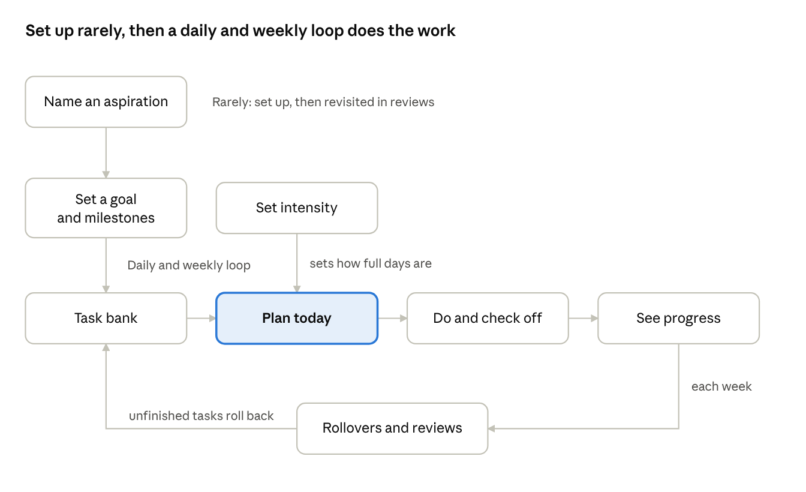

# Goals to Actions: Core Flows

Source of truth for how the app behaves, flow by flow. Moved here from the claude.ai design doc on 2026-11-09; update it in the same change as any behavior change. Data model: `data-model.md`. Screens: `screens/README.md`.

Eight flows cover the prototype: two you do rarely (aspirations, goals), and six that make up the daily and weekly rhythm. Each lists the steps, what the app does for you, and where it branches. In the prototype, you enter aspirations, goals, milestones and targets yourself; the app's automation goes into filling the weekly bank and placing recurring work, where it pays off most without guessing (ADR-013).

## At a glance

Aspirations and goals are set up rarely; after that, the bank, the daily plan, checking off and progress repeat every week, with rollovers feeding unfinished work back into the bank. Changing a goal from its page can also send you back to it when something has changed.

## Flow 1: Name an aspiration

Rare: on first use, or when something changes. It captures why you want what you want.

1. Tap **+** and pick **Aspiration**, or create one while setting a goal (flow 2).
2. Write it in your own words: "Be fit."
3. The app asks one question: "What would this give you?" Your answer becomes the why: "so I can keep skiing, biking and playing hockey at a high level for decades."
4. It goes last in priority. Move it up on its page if it should come first when aspirations compete for time.
5. Saved. The sheet stays open on "Saved." with **Add a goal for this**, which leads to flow 2 with the new aspiration selected, and **Done**.

Branches:

- **Skip the why:** the aspiration saves anyway. Add it later from the aspiration's page.
- **Start from a goal instead:** flow 2 can create the aspiration on the spot, or leave the goal without one.

**Managing aspirations afterwards** (from the aspiration's page, reached from the Aspirations tab):

- **Edit** the name and why at any time.
- **Reorder:** move up or move down. Priority order drives which goal work comes first when the week is tight, and the order on Week and in Today's by-goal view.
- **Retire:** the sheet leads with what the aspiration has seen (goals reached, goals active, recurring items), then asks one thing: pause its active goals and recurring items (default), or keep them going without an aspiration. Pausing them takes their unfinished tasks off this week's days and out of the bank, including ones you placed by hand; finished tasks stay. The aspiration moves to Retired, history intact. Nothing counts against you.
- **Bring back** a retired aspiration: active again, last in priority. Goals it paused stay paused until you resume them, and recurring items it paused stay off for now.

## Flow 2: Set a goal and its milestones

Rare: a few times a year per aspiration. It defines concretely what reaching the aspiration means to you. One aspiration can have several goals.

1. **Pick the goal type** first: building, quitting or one-off. It's one tap, and it shapes the questions that follow. Nothing else shows until it's picked, and it can be changed before saving. The app never guesses it from the sentence.
2. From an aspiration (**+ Add a goal for Be fit** on its page) or on its own (**+**, then **Goal**), type one sentence: "Be strong: bench 175, squat 350, deadlift 400."
3. The app splits it at the first colon into a **label** ("Be strong") and a **measurable line** (the numbers), and shows both back as you type. With no colon, the sentence is the label, and it asks for the line: "How will you know you've got there?" Every goal needs a finish line it could reach. There's no forced end date, though: a goal stays active as long as it's needed, until it's reached or you end it.
4. **Baseline:** "Where are you now?" (bench 145, squat 275, deadlift 315). Realistic targets depend on this.
5. **Milestones:** you add checkpoints, each with a measurable line and an optional date (week 8: bench 155, squat 300, deadlift 345). A date falls between the goal's start and its deadline. The goal itself is the final milestone. In the app the short Add form saves the goal first and opens its page: "Saved. Add milestones when you're ready." ("steps" for a one-off goal). Milestones are added there; a one-off goal has steps instead, which are tasks. Back from that page goes to the goal's aspiration, or to the Aspirations tab when it has none, whichever screen the + was tapped over. App suggestions come later.
6. **Optional deadline** for the goal, whatever its type. Opt-in only, and never before the goal's start date.
7. **Weekly target:** you enter it, and change it on the goal's page. It's either a count ("3 lifting sessions a week") or an amount over a number of sessions ("25 miles over 4 runs"). A count is met by tasks done; an amount by the values logged on them. A change takes effect this week, so "1 of 3" can become "1 of 4" midweek; earlier weeks keep the target they had. On Sunday evening, once next week is open, it takes effect from next week instead. A goal's sessions start in the week of its start date, and a goal made or brought back midweek gets at most one session for each day left in that week. App suggestions come later.
8. The app puts this week's tasks for the goal into the bank (flow 3).

Branches:

- **No aspiration yet:** the app asks "What's this for?" You can link one, create one, or skip.
- **Quitting goal:** instead of a weekly target, set a start date (today unless changed) and a daily all-or-nothing commitment. The finish line is the habit being broken, not a set number of days: you've quit when you don't really want one anymore.
  - **The daily answer** is held or slipped. A day with no answer is unknown, not a slip, so a week away isn't seven failures. It isn't a task: it never enters the bank or counts against the day's cap.
  - **The urge rating** is low, some or strong. It's offered beside the answer once a day is answered and can be ignored; it's never a prompt. Clearing the answer clears the rating too, so the day is back to unknown.
  - **Where:** a quiet row on Today (and any opened day up to today), and the goal's page, which shows the run ("12 days held") and the last 28 days to fill in or change.
  - **Reached** when you say so. The app can point out that the urge has stayed low for a while, but never marks the goal reached itself.
- **One-off goal:** set an optional deadline and a short list of steps. The steps are tasks that belong to the goal ("Step 3 of 6" is tasks done out of the goal's tasks, leaving out any you dropped), done in any order, since steps rarely depend on each other. Checking one off on Today finishes the step; there's nothing to mark a second time. A step that takes several sittings stays one unchecked task until it's finished, or you split it. A one-off goal has no milestones.

## Flow 3: Fill the task bank

Mostly automatic, once a week. The bank holds everything to get done this week, before it's assigned to days.

1. When a week opens, at 6 p.m. on the Sunday before it, the app fills its bank with:
   - goal tasks from weekly targets (3 lifting sessions),
   - steps from one-off goals that are due this week (a step is a task, so it arrives like any task with a due date),
   - recurring maintenance due this week (laundry, rent),
   - tasks from the upcoming list that are now due,
   - anything that rolled over from last week (flow 7). These arrive when last week closes, so after the rest unless you wrapped the week up.
2. Anytime, you can add a task by hand (**+**, the Task tab): a title, and optionally the goal it serves, a due date and a time of day ("by" or "at" a time). If it's due this week or earlier, or has no due date, it goes straight into this week's bank, or onto today if you choose. **On today** is preselected when you add it from the Today screen, not from a day opened on Week, even when that day is today. A new task can also go **On a day**: any day from today on, with an optional time, and it stays there (designed Nov 21, not built; `briefs/scheduling-and-other-weeks.md`). If it's due later, it waits in an upcoming list and moves into the bank when the week it's due opens. If that week is already open, it goes straight into its bank. A short line says where it went: "Added to this week's bank.", "Saved for the week of Nov 23." (next week's bank, once it's open), "Saved. It joins the week it's due." (the upcoming list) or "Added to today."
3. **Maintenance is set up once:** a name, a repeat and how fixed it is. Fixed-day items happen on a set day ("take out the trash every Tuesday," "rent on the 1st"), and the plan always puts them there. Flexible items just need doing sometime in the window ("laundry once a week," "clean the bathroom every two weeks"), and the app spreads them evenly across the week. Only the things that actually slip go in; automatic habits stay out. The same kind of recurring item can also keep up a practice after its goal ends (lifting 3 times a week, under Be fit).
   - **Adding one** (**+**, the Recurring tab, or **+ Add recurring** on an aspiration's page, which selects that aspiration): a name, then **Fixed day** or **Flexible**. Fixed: every week on a weekday, or every month on the 1st to the 28th, so every month has the day. Flexible: once a week, 2 to 6 times a week, every two weeks, or once a month. The repeat reads back as "Every Tuesday", "Monthly on the 1st", "3 times a week", "Every two weeks".
   - **Under an aspiration** is optional. With none, the item belongs to Keep life running.
   - **When it's first due:** a fixed item on its next day, today included when today is that day; a flexible item from the day it's added. "Added. It will show up in the plan when it's next due."
   - **Changing one** (its name, repeat or aspiration; the screen is front-end #76): this week's work follows, and next week's once it's open. Its open tasks take the new name. A fixed-day task moves to its new day if that day is today or later, and otherwise stays where it is. A new count or repeat adds tasks on later days or removes extra open ones, the bank first. A task you placed by hand, a task you've done and a carry-over from last week stay put. An item changed while it's off follows its new repeat when it comes back on.
   - Yearly repeats, "every N weeks" and a time of day ("Thursdays at 8 p.m.") aren't offered yet.

Branches:

- **Later weeks:** the app's plan exists for the current week and, from Sunday evening, the next one. Further out, a task waits in the upcoming list, or is pinned to a day with **On a day** (designed Nov 21, not built): its row waits in that week, and the planner places recurring work around it when the week opens.
- **A task with no goal:** fine. It's maintenance or a one-time life task ("fill out my ballot"), usually with a due date, and still part of the day. Things that come around once a year can be yearly recurring items instead, once those are offered.
- **A full bank:** it's your list to place from, not a backlog. Nothing in it is late, and the app doesn't suggest what to push or drop.

## Flow 4: Plan today

The heart of the app. The app places the recurring work, which has an obvious place; you place the rest, which only you know where it fits (ADR-013). Planning is a few taps on Sunday evening, or as the week goes.

1. **When the week opens:** the app places the week's recurring work, once.
   - **Fixed-day items** go on their day ("trash every Tuesday", "rent on the 1st").
   - **A goal's weekly sessions and flexible recurring items** are spread evenly across the week: 3 lifting sessions go on Monday, Wednesday and Friday. Where there's a choice, they go on the lighter days, maintenance first, then goals in the order of their aspirations.
   - **Everything else waits in the bank:** tasks you added, a one-off goal's steps, tasks now due, and carry-overs. You put them on days yourself, on Next week from Sunday evening or any time during the week.
   - **The cap is a guide** (flow 8). A day that reaches it shows as full; the app doesn't hold anything back or move anything because of it.
2. **Throughout the week:** the plan is yours to change. You can look ahead at any day and adjust it, and there's no finalize step. Today's plan changes only because of something you did.
3. **Whenever you open it** (often the next morning): today's plan is shown in three groups: keeping life running, moving forward, and free time. Free time is the time tasks don't fill; it holds no tasks.
4. You can:
   - **accept it** by doing nothing,
   - **swap** a task for one from the bank,
   - **skip** a task, which sends it back to the bank (shown as "Back to bank"),
   - **pull extra** work forward from the bank.
5. After that, the app only places new recurring work as it arrives (a new goal's sessions, a raised target, a new or changed recurring item), spread over the days after today. Changing a recurring item is the one time it moves what the app placed: that item's tasks follow the change (flow 4, step 3). Carry-overs go to the bank. It doesn't move what's on a day and doesn't refill a slot you freed: a task sent back to the bank stays there, and finishing early leaves the time free.

Branches:

- **You never open the plan:** it still stands. Skipping planning doesn't mean having no plan.
- **A day reaches the cap:** Week shows it as full. Nothing is moved.
- **You edit a future day:** it stays there, and the app places new recurring work around it.
- **You first open the app midweek:** the week's recurring work is placed from that day on. A fixed-day item whose day has passed goes on that day.

## Flow 5: Do and check off

Daily, and the most frequent interaction. It has to take one tap.

1. Each task on today's plan shows the goal it serves and, where there is one, the aspiration behind it ("Lift: bench day · Be strong · Be fit").
2. Tap to mark it done. Tap again to undo a mis-tap.
3. For tasks with a number attached, an optional quick value (miles, weight, minutes): one field, skippable.
4. Pacing updates right away: "2 of 3 lifting sessions, 3 days left." For an amount target it's the total logged: "14 of 25 miles".

Branches:

- **Did something that wasn't planned:** log it as done. It counts the same as planned work. Doing a planned session early is checking it off where it sits, on its day or pulled from the bank. A task you add by hand under a building goal counts towards the week's target too; the app doesn't remove a session to make up for it, so one may be left over. Send it to the bank, or let it lapse with the week.
- **Partly done:** for the prototype, a task is done or not. Partial credit can come later if it's missed.
- **No connection:** checking off, moving a task and adding one show at once and are sent when the connection is back. If a send fails and changes are waiting, Today says so in one quiet line ("3 changes waiting to send"). A change that no longer applies (the task was deleted on the laptop) is dropped without a message. Anything that needs the server's planning, such as a new goal, a pause or wrapping up, waits for a connection.

## Flow 6: See progress and check in at milestones

Whenever you want to look, plus a check-in at each milestone. It shows improvement, not just effort.

1. **Per goal:** this week's pacing, milestones hit, and how far you've come from your baseline. On the goal's page:
   - **Where you started:** "Started at" (the baseline) and "Latest" (the most recent check-in result), side by side as text. Nothing is calculated, since both are free text.
   - **The timeline** runs from Start through each milestone to the goal itself, with "1 of 6 hit" beside it. Each milestone shows its week ("Wk 9 · Nov 30"; the week the goal starts is Wk 1), or "No date".
   - **Next** is the first milestone that isn't hit. One marked "not yet" stays Next until it's hit, so a check-in never passes over a milestone. Once every milestone is hit, the goal is Next.
2. **Overall:** each aspiration with its goals, so you can see the whole picture at a glance.
3. **Milestone check-in:** whenever you choose, tap Check in under Next check-in: "How did it go?", an optional result, then **Hit it** or **Not yet**. Milestones are checked in in order, so only Next can be. Each check-in is kept, so results have a history. A one-off goal has no check-ins: its steps are tasks, checked off like any other.
4. **Milestone hit:** a short "Milestone hit: …" line, and Next moves to the following milestone right away, so progress points forward. With every milestone hit, the goal itself is Next; hitting it marks the goal reached, exactly as End goal → I reached it does. Not yet on the goal itself is kept like any check-in: the goal carries on, and its result becomes Latest.

Branches:

- **Not yet:** the milestone is marked not yet with your result, and it stays Next. A card on the goal's page leads with progress since your baseline ("You started at … Now: …"), then offers: **keep the date**, **move it**, or **adjust the milestone** (its line and date). Each puts it back to upcoming. The card stays until you pick one, and never appears anywhere else.
- **Moving a date pushes the later ones out:** whenever a milestone's date moves later, whether through **move it** or **adjust the milestone**, every later milestone with a date moves by the same number of days, never past the goal's deadline (one that would lands on the deadline). Undated ones stay undated, and moving a date earlier pulls nothing in.
- **A milestone's date passes:** nothing changes by itself, and there's no badge. It reads like any other date until you check in.
- **No date on the milestone:** Next check-in reads "Whenever you choose."

## Flow 7: Rollovers and light reviews

Mostly automatic. The app asks short questions only when something suggests it should, and never makes you do a review.

**Weekly rollover (end of each week):**

The week closes when Sunday ends: on Monday, the first time the app is opened. Or sooner, if you choose. From Sunday evening the Week screen shows **Next week**, and on it **Wrap up this week**. A short sheet says what carries over and what ends with the week. Confirming closes the week then and makes next week the current one, so anything done later that night counts towards it. Until Monday, a new task goes to the bank, not onto today. There's no undo. It's never asked for: leave it, and the week closes by itself.

1. Unfinished tasks you added yourself, a one-off goal's steps included, move into next week's bank, with no penalty. So do fixed-day recurring items: rent missed on the 1st still has to be paid.
2. Unfinished weekly-target tasks lapse: a week of 1 of 3 is followed by a week of 3, not 5. A flexible recurring item lapses at the end of its period (laundry not done this week is replaced by next week's). Nothing counts against you, and the miss stays in your history.
3. When a task you added, or a fixed-day item, has been carried over for two weeks, the app asks: "Still matter?" Keep it, reschedule it, or drop it. After Keep, it asks again only once the task has carried over two more weeks. A dropped task stays in your history; it isn't deleted.

**Changing a goal (only when you choose to; the app doesn't prompt):**

4. From a goal's page: change the weekly target, **Pause** or **Resume** it, or **End goal**. Pausing is immediate: the goal's unfinished tasks leave the days and the bank (done ones stay), in this week and in next week once it's open, and it drops out of Week's progress. Resuming returns them to the bank of the week they belong to. After a longer pause the goal gets the current week's sessions fresh; last week's don't come back. Turning a recurring item off and on works the same way. A goal whose aspiration is retired can be resumed too; it keeps the aspiration and shows under Other goals until the aspiration is brought back.
5. Neither goals nor aspirations have a Review (decided Nov 10). A review's choices (adjust the target, pause, end; or edit, move, retire for an aspiration) already sit on their pages, and nothing would show when one was last reviewed.

**When a goal ends** (reached, deadline passed, or you end it):

6. **End goal** leads with what you achieved: where you started, the latest result, and milestones hit. Then you say which it is, **I reached it** or **End it for now**, since only you can tell whether the line was crossed. Ending sets the goal's unfinished tasks aside, like a pause; **Reopen** or **Go again** returns them.
7. **Reached:** the goal counts complete; milestones you never checked in were passed on the way, and read so. A quiet **Reopen** undoes it, in case you reached it by mistake. "What's next for Be fit?" This guards against the drop-off after a big finish. If the practice behind the goal has become part of your life, the app offers to keep it going as a recurring item under the aspiration. The item remembers the goal it came from.
8. **Not reached:** the page reads "Not yet." with the same lines. **Go again** makes it active, with its target and milestones as they were, ready to adjust or rethink. It's the same goal with its history, not a new attempt.

Branch:

- **An opt-in deadline passes:** "This one slipped." Two choices: **push it back** to a new date, or, when the date was firm and has passed, **end the goal for now**, exactly as End goal → End it for now does, with Go again still there. The card shows while the goal is active with its deadline behind it.

**Deleting (for mistakes):**

9. A task, milestone, goal, aspiration or recurring item made by mistake can be deleted. It asks once first, and there's no undo. It disappears everywhere; deleting a goal takes its tasks, milestones and records with it. Deleting an aspiration leaves its goals and recurring items with none (Other goals, Keep life running). Deleting a recurring item takes its open tasks; the ones done stay in history. This isn't dropping: a dropped task was a decision and stays in history. No screen offers delete yet.

## Flow 8: Set intensity

Anytime, and only when you choose. The app never prompts about pace.

1. Pick **Going hard**, **Normal** or **Easing off**.
2. Intensity sets how many tasks make a day full: 3 for Easing off, 4 for Normal, 6 for Going hard. Everything on the day counts, done tasks too; dropped and set-aside ones don't. It's a guide: Week shows a day that reaches it as full, and you can go over it.
3. Changing it moves nothing. The new cap shows on Week at once (ADR-013).
4. For the prototype, the setting stays until you change it. Whether it should be able to expire on its own is left open.

## Flow 9: Look ahead and look back

Designed Nov 21; not built. Details and suggested work: `briefs/scheduling-and-other-weeks.md`.

1. **Any week:** on Week, ‹ › step to past weeks and up to 12 weeks ahead. Every week shows how full it is: a counts line ("● 8 for 3 goals · ● 5 upkeep · ● 2 added") and a bar against a typical week of 25.
2. **A week that hasn't opened** shows only what's already known: tasks set to a day, fixed-day recurring items, milestone dates and deadlines. The rest is placed when it opens.
3. **A past day:** open it and tick off what you did but didn't mark. It counts for that day; a task that rolled over leaves this week's bank.
4. **Coming up:** from Week or the line at the bottom of Today, the next 12 weeks at a glance: how full each looks, and what's set, due or checked in. Tap a thing to open its day or goal.
5. **Put something on a day:** the Add sheet's **On a day**, or Move on a future day's set item. It stays put.

Branches:

- **A week looks full:** nothing happens. Fullness is a guide, like the day cap.
- **A check-in or deadline in a week:** listed with a hollow ring, never counted toward fullness.

## Edge cases and open questions

Edge cases the prototype needs an answer for:

- **First run, nothing set up:** start with one sentence, either a goal or a maintenance item, and get a plan for tomorrow right away.
- **Away or sick for a while:** pause one goal or everything, so the gap doesn't count as missed and nothing piles up while you're gone.
- **A whole week with no tasks done:** rollover still happens quietly; the first open afterwards shows how far you've come, not what you missed.
- **A week you never opened:** it's skipped. Nothing is created just to lapse, and what you'd added yourself, including anything set to a day in the gap, carries straight into the week you come back to, as one carry-over. A fixed-day item due in the gap doesn't appear.
- **One task serving two goals:** for the prototype, each task belongs to one goal.
- **Travelling between time zones:** a task's day and time carry no zone, so Tuesday at 6 p.m. is Tuesday at 6 p.m. wherever you are. Today is your phone's date. The week never goes backwards: fly west across Sunday midnight after the new week has started and you stay in the new week. Crossing the date line skips or repeats a date; a skipped day's tasks are simply unfinished.

Settled questions (kept so the reasoning isn't lost):

- Decided: no separate per-day capacity setting for the prototype. Intensity is the one dial; add per-day capacity only if days keep feeling overpacked. No time estimates per task.
- Decided: free time is protected by capping how many tasks go on a day, set by intensity (normal by default).
- Decided: no set finalize time. You can look ahead anytime and adjust; today's plan changes only because of something you did. (Nov 16: "the plan updates continuously" became "the app drafts once", below.)
- Decided: anything you explicitly schedule on a day stays there, and the app plans around it.
- Decided: the week starts on Monday.
- Decided: intensity defaults to normal and stays as set until you change it; no automatic expiry for now.
- Decided: the app asks "Still matter?" once a task has been carried over for two weeks, however many times it moved. Saying no drops it, with no penalty; ignoring the question just lets it keep rolling over.
- Decided: no review prompts, and no Review on a goal either (Nov 10). Changing a goal is something you do when you want to, from its page.
- Decided: a not-yet milestone stays Next until it's hit; a check-in never passes over one. Moving its date later pushes the later dated milestones out by as much, capped at the deadline (Nov 10).
- Decided: a one-off goal's steps can be done in any order (Nov 10). They are tasks, not milestones (Nov 13, replacing the Nov 10 decision that they were milestones marked on the goal's page).
- Decided: a reached goal counts complete, with milestones never checked in shown as passed on the way, and can be reopened (Nov 11).
- Decided: a goal whose aspiration is retired can be resumed on its own; it shows under Other goals until the aspiration is brought back (Nov 10).
- Decided: a new fixed-day recurring item whose day is today is due today, not next week or next month (Nov 11).
- Decided: unfinished weekly-target tasks and flexible recurring items lapse; hand-added tasks and fixed-day items roll over (Nov 13, replacing "everything rolls over").
- Decided: a slipped deadline is pushed back or ends the goal; "recommit" and "rethink" are gone, and there's no "missed" status (Nov 13).
- Decided: a quitting goal's unanswered day is unknown, not a slip; the urge rating has three levels and is never a prompt (Nov 13).
- Decided: a run of held days counts held answers since the last no. Unknown days don't break it, and the goal's page counts them so they can be filled in later, which gently invites it (Nov 19).
- Decided: drop and delete are different; delete is for mistakes and is offered on everything (Nov 13).
- Decided: deleting an aspiration leaves its goals and items with none; deleting a recurring item keeps its done tasks; no undo (Nov 19).
- Decided: a recurring item is on or off; paused by a retired aspiration and turned off by hand are the same state (Nov 13).
- Decided: aspirations have no Review. Its choices repeated Edit, move up or down and Retire, which sit on the aspiration's page anyway.
- Decided: a week opens at 6 p.m. on the Sunday before it, and closes when Sunday ends or when you wrap it up. There's no job, and a week nobody opened is skipped (Nov 16, ADR-009).
- Decided: the app places a week's recurring work once, then only places new recurring work as it arrives. "Back to bank" means the bank, and a freed slot isn't refilled (Nov 16, replacing "any change reflows the rest of the week's draft").
- Decided: the cap is 3, 4 or 6 tasks a day and counts everything on the day. It's a guide shown on Week: the app never moves or refuses anything because of it (Nov 19, replacing "the planner never takes a day over the cap" from Nov 16).
- Decided: a day is full once it reaches the cap (4 tasks on Normal), so the mark is consistent; some days just have to be busy, and nothing is capped or removed. The planner doesn't look at the cap when it places recurring work (Nov 19).
- Decided: the app places only recurring work. Fixed-day items go on their day; a goal's sessions and flexible items are spread evenly. Everything else, carry-overs included, waits in the bank for you to place (Nov 19, ADR-013, replacing a full draft of the week with goals taking turns under the cap).
- Decided: a task added by hand under a building goal counts towards its target, and the app never removes a session to make up for it. A one-off goal's step with no date waits on the goal's page until you pull it in or date it (Nov 16).
- Decided: wrapping up doesn't change what rolls over. Sessions still lapse; a week of 1 of 3 is followed by 3 (Nov 16).
- Decided: ending or reaching a goal sets its unfinished tasks aside like a pause, and so does turning a recurring item off. Coming back makes the current week's sessions fresh (Nov 16, replacing "ending moves no tasks").
- Decided: a recurring item under an aspiration is planned as goal work at that priority; one with none is maintenance (Nov 16).
- Decided: once next week is open, a target change takes effect from next week. Every other change acts on both open weeks (Nov 16).
- Decided: changing a recurring item moves this week's work, not only from its next period. Only tasks the app placed or in the bank move, to a new day from today on; a count change acts like a target change; carry-overs stay (Nov 20 and 25, API #49).
- Decided: only tasks you added and fixed-day items are asked "Still matter?". A flexible item's period is whole weeks; a month is the weeks whose Monday falls in it (Nov 16).
- Decided: a check-off that arrives late, dated inside a closed week, still counts: a lapse isn't final (Nov 16).
- Decided: a goal made or brought back midweek gets at most one session for each day left that week (Nov 16).
- Decided: offline, only the frequent plan actions queue (check off, uncheck, place, back to bank, swap, add a task, a quitting answer); everything else needs a connection. A refused change is dropped silently, and Today shows one quiet line while changes are waiting (ADR-010).
