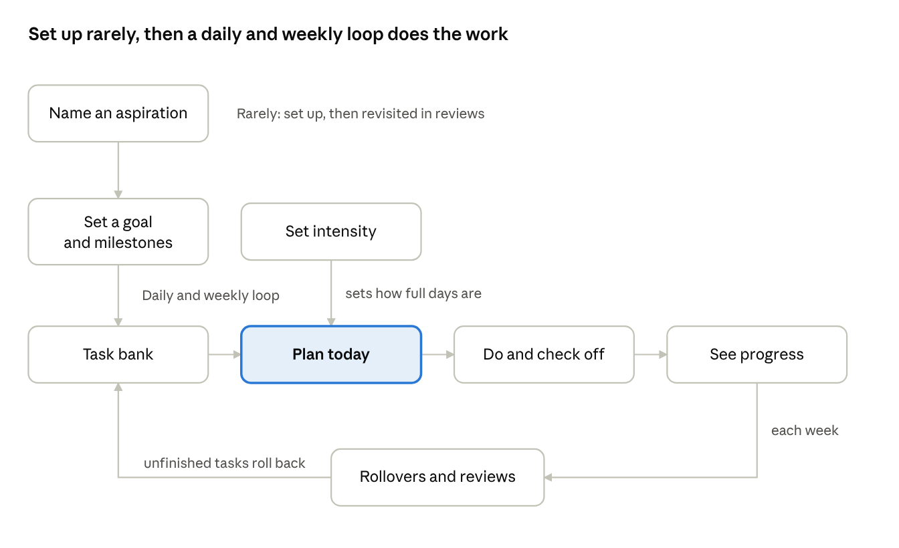

# Goals to Actions: Core Flows

Source of truth for how the app behaves, flow by flow. Moved here from the claude.ai design doc on 2026-11-09; update it in the same change as any behavior change. Data model: `data-model.md`. Screens: `screens/README.md`.

Eight flows cover the prototype: two you do rarely (aspirations, goals), and six that make up the daily and weekly rhythm. Each lists the steps, what the app does for you, and where it branches. In the prototype, you enter aspirations, goals, milestones and targets yourself; the app's automation goes into filling the weekly bank and planning each day, where it pays off most.

## At a glance

Aspirations and goals are set up rarely; after that, the bank, the daily plan, checking off and progress repeat every week, with rollovers feeding unfinished work back into the bank. A goal's review can also send you back to it when something has changed.

## Flow 1: Name an aspiration

Rare: on first use, or when something changes. It captures why you want what you want.

1. Tap **Add aspiration**, or the app offers it when a goal has none.
2. Write it in your own words: "Be fit."
3. The app asks one question: "What would this give you?" Your answer becomes the why: "so I can keep skiing, biking and playing hockey at a high level for decades."
4. It goes last in priority. Move it up on its page if it should come first when aspirations compete for time.
5. Saved. The app offers **Add a goal for this**, which leads to flow 2.

Branches:

- **Skip the why:** the aspiration saves anyway. Add it later from the aspiration's page.
- **Start from a goal instead:** flow 2 can create the aspiration on the spot, or leave the goal without one.

**Managing aspirations afterwards** (from the aspiration's page, reached from the Aspirations tab):

- **Edit** the name and why at any time.
- **Reorder:** move up or move down. Priority order drives which goal work comes first when the week is tight, and the order on Week and in Today's by-goal view.
- **Retire:** the sheet leads with what the aspiration has seen (goals reached, goals active, recurring items), then asks one thing: pause its active goals and recurring items (default), or keep them going without an aspiration. Pausing them takes their unfinished tasks off this week's days and out of the bank, including ones you placed by hand; finished tasks stay. The aspiration moves to Retired, history intact. Nothing counts against you.
- **Bring back** a retired aspiration: active again, last in priority. Goals it paused stay paused until you resume them, and recurring items it paused stay off for now.

## Flow 2: Set a goal and its milestones

Rare: a few times a year per aspiration. It defines concretely what reaching the aspiration means to you. One aspiration can have several goals.

1. **Pick the goal type** first: building, quitting or one-off. It's one tap, and it shapes the questions that follow.
2. From an aspiration (or on its own), type one sentence: "Be strong: bench 175, squat 350, deadlift 400."
3. The app splits it into a **label** ("Be strong") and a **measurable line** (the numbers). If there's no measurable line, it asks: "How will you know you've got there?" Every goal needs a finish line it could reach. There's no forced end date, though: a goal stays active as long as it's needed, until it's reached or you end it.
4. **Baseline:** "Where are you now?" (bench 145, squat 275, deadlift 315). Realistic targets depend on this.
5. **Milestones:** you add checkpoints, each with a measurable line and an optional date (week 8: bench 155, squat 300, deadlift 345). A date falls between the goal's start and its deadline. The goal itself is the final milestone. In the app the short Add form saves the goal first; milestones are added on its page. App suggestions come later.
6. **Optional deadline** for the goal. Opt-in only.
7. **Weekly target:** you enter it ("3 lifting sessions a week"), and change it on the goal's page. A change takes effect this week, so "1 of 3" can become "1 of 4" midweek; earlier weeks keep the target they had. App suggestions come later.
8. The app puts this week's tasks for the goal into the bank (flow 3).

Branches:

- **No aspiration yet:** the app asks "What's this for?" You can link one, create one, or skip.
- **Quitting goal:** instead of a weekly target, set a start date and a daily all-or-nothing commitment. The finish line is the habit being broken, not a set number of days: you've quit when you don't really want one anymore. The app occasionally asks how strong the urge is, and the goal is reached when it has stayed low for a while, or when you say so.
- **One-off goal:** set an optional deadline and a short list of steps. The steps are the goal's milestones: you mark each one reached on the goal's page ("Step 3 of 6"). The tasks that get a step done are ordinary tasks for the goal; checking one off doesn't move the step.

## Flow 3: Fill the task bank

Mostly automatic, once a week. The bank holds everything to get done this week, before it's assigned to days.

1. At the start of each week, the app fills the bank with:
   - goal tasks from weekly targets (3 lifting sessions),
   - steps from one-off goals that are due soon,
   - recurring maintenance due this week (laundry, rent),
   - anything that rolled over from last week (flow 7), and tasks from the upcoming list that are now due.
2. Anytime, you can add a task by hand: a title, and optionally the goal it serves and a due date. If it's due this week or has no due date, it goes straight into this week's bank, or onto today if you choose (the default when you add it from Today). If it's due later, it waits in an upcoming list and moves into the bank at the start of the week it's due (or a week or two early, for things that need lead time).
3. **Maintenance is set up once:** a name, a repeat and how fixed it is. Fixed-day items happen on a set day ("take out the trash every Tuesday," "rent on the 1st"), and the plan always puts them there. Flexible items just need doing sometime in the window ("laundry once a week," "clean the bathroom every two weeks"), and the app places them on whichever day fits. Only the things that actually slip go in; automatic habits stay out. The same kind of recurring item can also keep up a practice after its goal ends (lifting 3 times a week, under Be fit).

Branches:

- **A task with no goal:** fine. It's maintenance or a one-time life task ("fill out my ballot"), usually with a due date, and still part of the day. Things that come around once a year can be yearly recurring items instead.
- **More in the bank than the week can hold:** the app says so, and suggests what to push to next week or drop.

## Flow 4: Plan today

The heart of the app, and the most automated part. Planning should mostly be a glance and an "OK."

1. **Start of the week:** the app drafts the whole week from the bank. It places maintenance on its due days first, spreads goal work across the week (learning your rhythm over time), leaves free time, and follows your intensity setting (flow 8).
2. **Throughout the week:** the plan updates continuously as tasks get done, skipped or moved, so you can look ahead at any day and adjust it. Today's plan changes only because of something you did.
3. **Whenever you open it** (often the next morning): today's plan is shown in three groups: keeping life running, moving forward, and free time. Free time is the time tasks don't fill; it holds no tasks.
4. You can:
   - **accept it** by doing nothing,
   - **swap** a task for one from the bank,
   - **skip** a task, which sends it back to the bank (shown as "Back to bank"),
   - **pull extra** work forward from the bank.
5. Any change reflows the rest of the week's draft.

Branches:

- **You never open the plan:** it still stands. Skipping planning doesn't mean having no plan.
- **A day is overloaded:** the app says so and suggests what to move, instead of quietly packing it full.
- **You edit a future day:** it stays there, and the app plans the rest of the week around it.

## Flow 5: Do and check off

Daily, and the most frequent interaction. It has to take one tap.

1. Each task on today's plan shows the goal it serves and, where there is one, the aspiration behind it ("Lift: bench day · Be strong · Be fit").
2. Tap to mark it done. Tap again to undo a mis-tap.
3. For tasks with a number attached, an optional quick value (miles, weight, minutes): one field, skippable.
4. Pacing updates right away: "2 of 3 lifting sessions, 3 days left."

Branches:

- **Did something that wasn't planned:** log it as done. It counts the same as planned work.
- **Partly done:** for the prototype, a task is done or not. Partial credit can come later if it's missed.

## Flow 6: See progress and check in at milestones

Whenever you want to look, plus a check-in at each milestone. It shows improvement, not just effort.

1. **Per goal:** this week's pacing, milestones hit, and how far you've come from your baseline. On the goal's page:
   - **Where you started:** "Started at" (the baseline) and "Latest" (the most recent check-in result), side by side as text. Nothing is calculated, since both are free text.
   - **The timeline** runs from Start through each milestone to the goal itself, with "1 of 6 hit" beside it. Each milestone shows its week ("Wk 9 · Nov 30"; the week the goal starts is Wk 1), or "No date".
   - **Next** is the first milestone that isn't hit. One marked "not yet" stays Next until it's hit, so a check-in never passes over a milestone. Once every milestone is hit, the goal is Next.
2. **Overall:** each aspiration with its goals, so you can see the whole picture at a glance.
3. **Milestone check-in:** as a milestone's date approaches, or whenever you choose, the app offers a quick benchmark ("Test your maxes this week"). You enter the result.
4. **Milestone hit:** a brief celebration, then the next milestone right away, so progress points forward.

Branches:

- **Milestone date passes without hitting it:** "Not yet." The app leads with progress since your baseline, then asks: keep the date, move it, or adjust the milestone.
- **No date on the milestone:** the check-in waits until you choose to do it.

## Flow 7: Rollovers and light reviews

Mostly automatic. The app asks short questions only when something suggests it should, and never makes you do a review.

**Weekly rollover (end of each week):**

1. Unfinished tasks move into next week's bank, with no penalty.
2. When a task has been carried over for two weeks, the app asks: "Still matter?" Keep it, reschedule it, or drop it.

**Light review (only when you choose to; the app doesn't prompt):**

3. A short card per goal: still important? Is the weekly target right? Keep, adjust the target, pause, or end the goal. Pausing a goal sets its unfinished tasks aside for the week; resuming returns them to the bank.
4. Aspirations have no review of their own (decided Nov 10). Their page already has what a review would lead to: edit the name and why, move up or down, retire.

**When a goal ends** (reached, deadline passed, or you end it):

5. The app leads with what you achieved: baseline to now, and milestones hit.
6. **Reached:** "What's next for Be fit?" This guards against the drop-off after a big finish. If the practice behind the goal has become part of your life, the app offers to keep it going as a recurring item under the aspiration.
7. **Not reached:** "Not yet." Go again at the same target, adjust it, or rethink the goal.

Branch:

- **An opt-in deadline passes:** "This one slipped. Push it back, recommit, or rethink the goal?"

## Flow 8: Set intensity

Anytime, and only when you choose. The app never prompts about pace.

1. Pick **Going hard**, **Normal** or **Easing off**.
2. From the next draft, the plan adjusts: more or less goal work, more or less free time. Maintenance stays the same.
3. For the prototype, the setting stays until you change it. Whether it should be able to expire on its own is left open.

## Edge cases and open questions

Edge cases the prototype needs an answer for:

- **First run, nothing set up:** start with one sentence, either a goal or a maintenance item, and get a plan for tomorrow right away.
- **Away or sick for a while:** pause one goal or everything, so the gap doesn't count as missed and nothing piles up while you're gone.
- **A whole week with no tasks done:** rollover still happens quietly; the first open afterwards shows how far you've come, not what you missed.
- **One task serving two goals:** for the prototype, each task belongs to one goal.

Settled questions (kept so the reasoning isn't lost):

- Decided: no separate per-day capacity setting for the prototype. Intensity is the one dial; add per-day capacity only if days keep feeling overpacked. No time estimates per task.
- Decided: free time is protected by capping how many tasks go on a day, set by intensity (normal by default).
- Decided: no set finalize time. The plan updates continuously, so you can look ahead anytime and adjust; today's plan changes only because of something you did.
- Decided: anything you explicitly schedule on a day stays there, and the app plans around it.
- Decided: the week starts on Monday.
- Decided: intensity defaults to normal and stays as set until you change it; no automatic expiry for now.
- Decided: the app asks "Still matter?" once a task has been carried over for two weeks, however many times it moved. Saying no drops it, with no penalty; ignoring the question just lets it keep rolling over.
- Decided: no review prompts. Reviewing a goal is something you do when you want to, from its screen.
- Decided: aspirations have no Review. Its choices repeated Edit, move up or down and Retire, which sit on the aspiration's page anyway.
