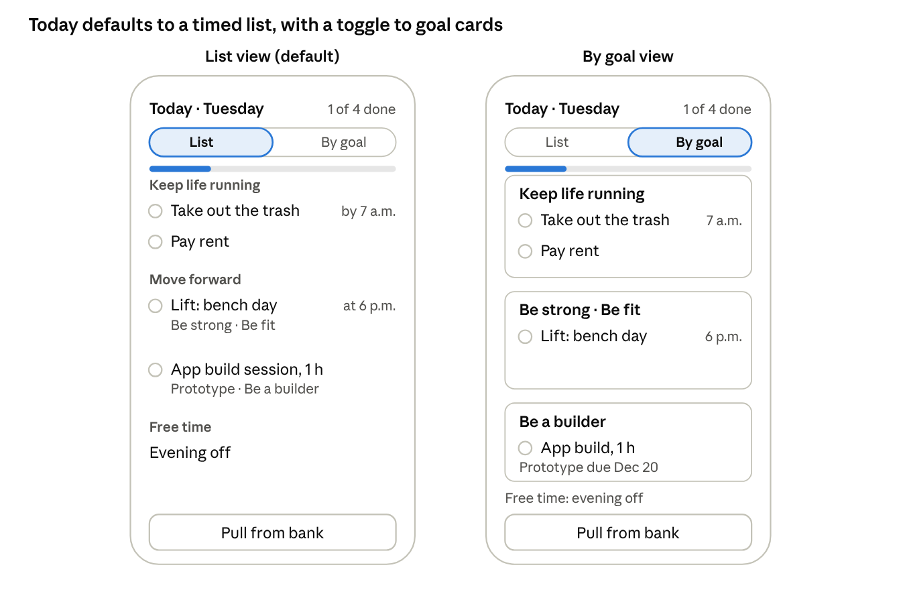
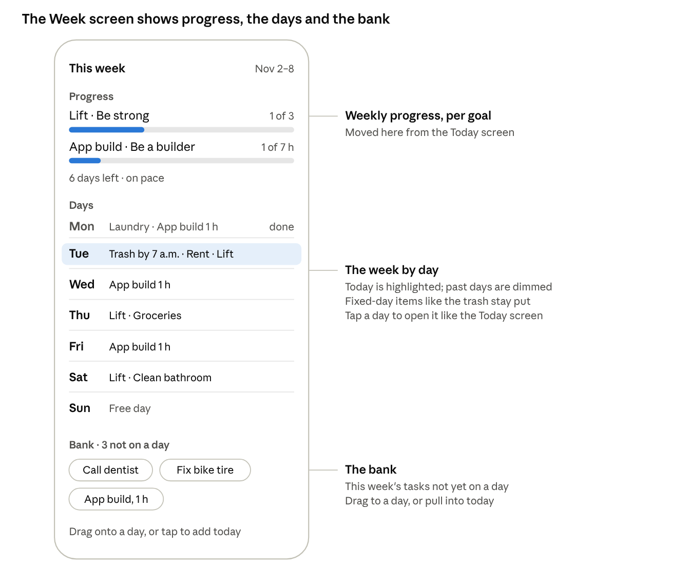
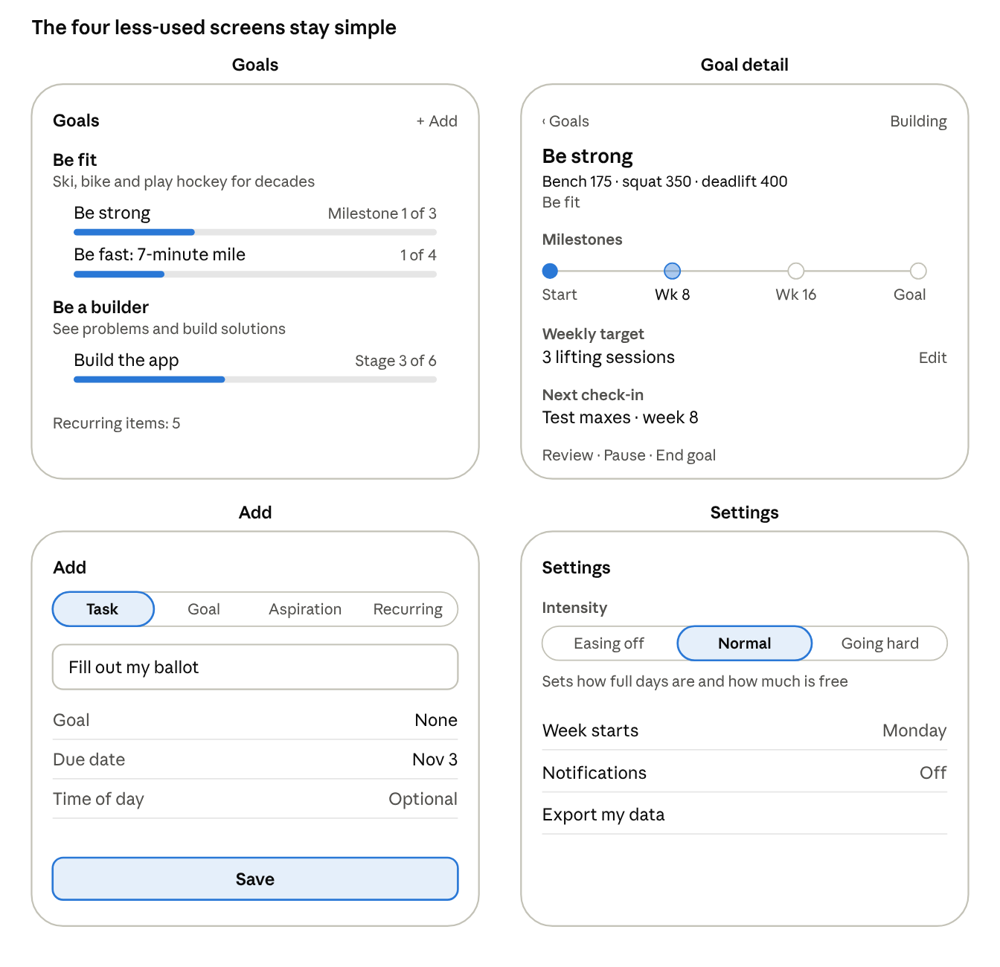
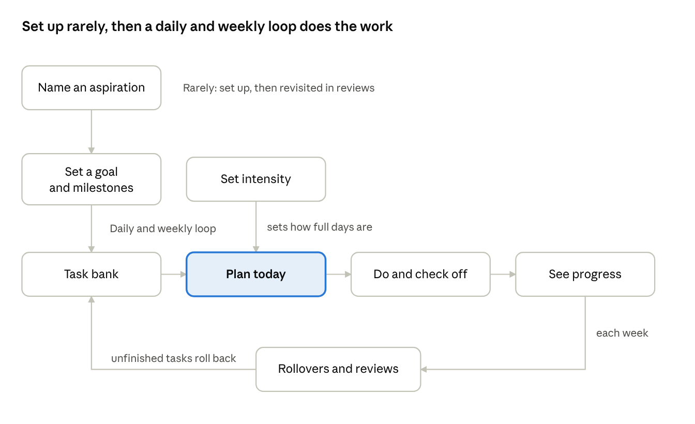

# Screens

Low-fidelity sketches from stage 3 (Nov 2, 2026). They settle layout and behavior, not visual style; hi-fi designs were judged unnecessary for the prototype. Behavior details live in `../flows.md`.

## Today (home screen)

- Three groups: **Keep life running**, **Move forward**, **Free time**. Keep life running holds maintenance and tasks with no goal ("Fill out my ballot"). Free time is the time tasks don't fill, not a list of tasks; it reads "The rest is yours." Timed tasks show "by 7 a.m." or "at 6 p.m." and anchor the order; untimed tasks follow.
- Each goal task shows its goal and aspiration ("Be strong · Be fit"). In **By goal**, each card is titled the same way.
- Tap a task to mark it done; tap again to undo.
- Progress for today at the top ("1 of 4 done"). Weekly progress per goal lives on the Week screen.
- Toggle between **List** (default) and **By goal**. The chosen view is remembered (ADR-004).
- **Pull from bank** adds extra work. Each task's **⋯** menu offers **Back to bank** (skipping, in flows.md) and **Swap** for a bank task, which takes its place in the day. Done tasks have no menu. Swipe gestures may come later.

## Week

- Weekly progress per goal ("1 of 3") with a pacing line: "6 days left · on pace", "6 days left · 1 more to plan", or "Done for the week". Nothing else, and never a warning.
- Monday to Sunday. Today highlighted, past days dimmed; an empty day reads "Free day". Tap a day to open it like Today, with every Today action; "‹ Week" goes back. On past days, Pull from bank and Swap are hidden.
- Fixed-day items (trash on Tuesday) stay put: they have no ⋯ menu, but can be checked off.
- **The bank:** this week's tasks not yet on a day, as chips. Tap one, then pick a day (today or later). Drag may come later. Anything placed by hand stays put.
- A tab bar (Today | Week) switches screens; the open screen, including an opened day, is remembered.

## Goals, Goal detail, Add, Settings

- **Goals:** aspirations with their why, and each goal's progress (milestone count, or stage for one-off goals). Count of recurring items.
- **Goal detail:** label, measurable line, aspiration, type, milestone timeline, weekly target (editable), next check-in. Review, Pause and End goal live here; reviews are never prompted.
- **Add:** one sheet with Task / Goal / Aspiration / Recurring tabs. A task needs only a title; goal, due date and time of day are optional.
- **Settings:** intensity (Easing off / Normal / Going hard), week starts Monday, notifications (off), export my data.

## Core loop

## Screen inventory

Six screens cover the prototype. Prompts like "still matter?", reviews and "not yet" appear as cards on these screens, not as screens of their own.

| Screen | Used | What it does | Flows |
| --- | --- | --- | --- |
| Today | Daily, the home screen | Today's plan in three groups; check off, swap, skip; pacing | 4, 5 |
| Week | A few times a week | The week's draft by day, plus the bank; move tasks between days and the bank | 3, 4, 7 |
| Goals | Weekly or less | Aspirations with their goals and progress at a glance | 1, 6 |
| Goal detail | Weekly or less | Label, measurable line, baseline, milestones, weekly target, progress, check-ins | 2, 6, 7 |
| Add / edit | Rarely | One-sentence entry for an aspiration, goal, task or maintenance item | 1, 2, 3 |
| Settings | Rarely | Intensity (which sets how much free time is protected), notifications | 8 |
