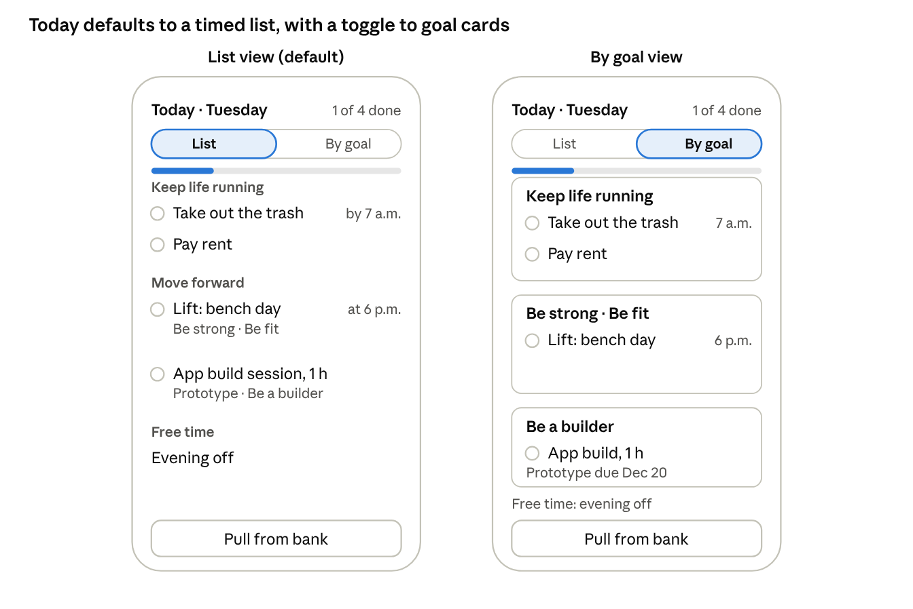
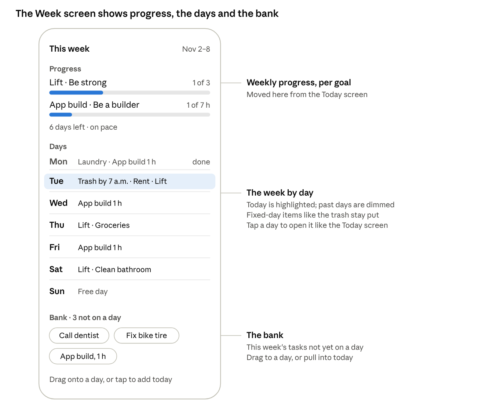
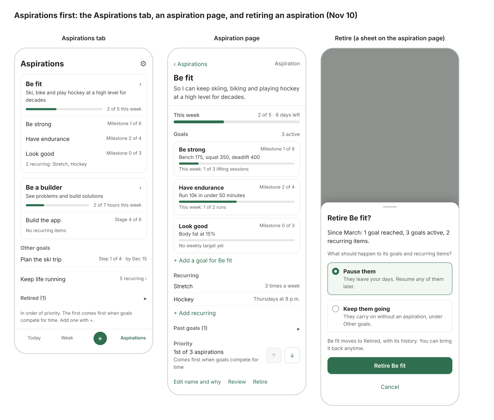
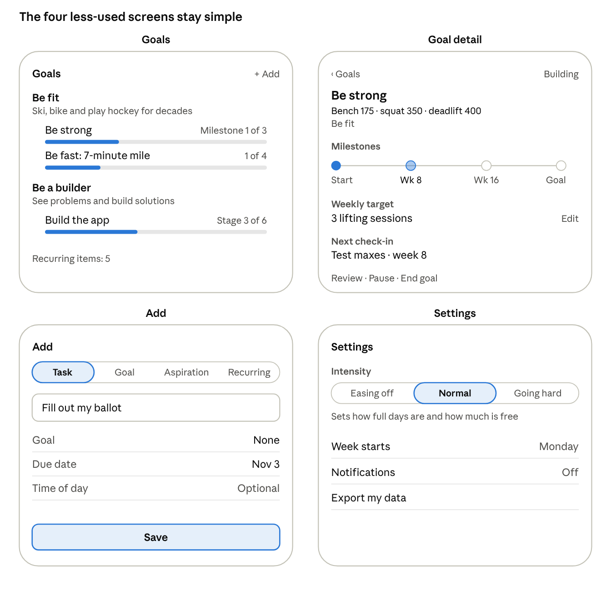
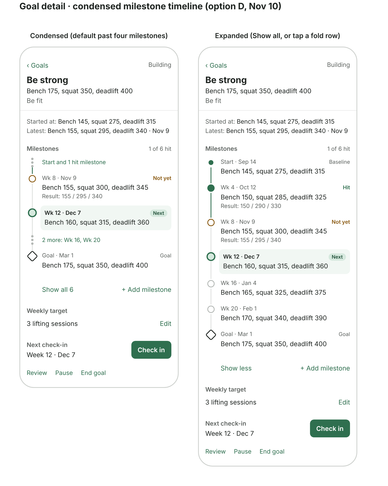
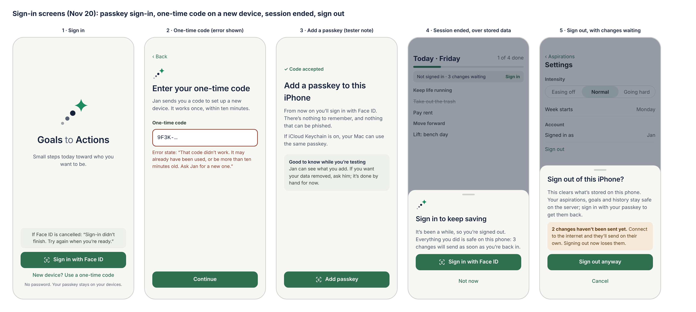
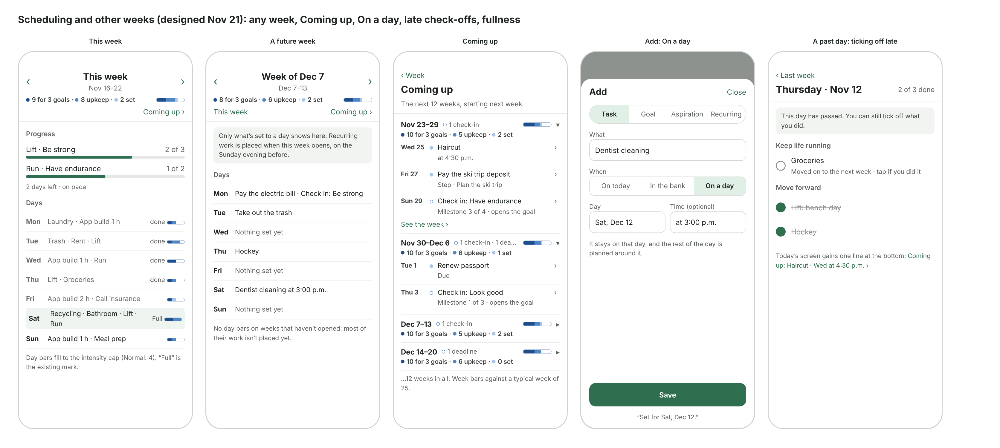
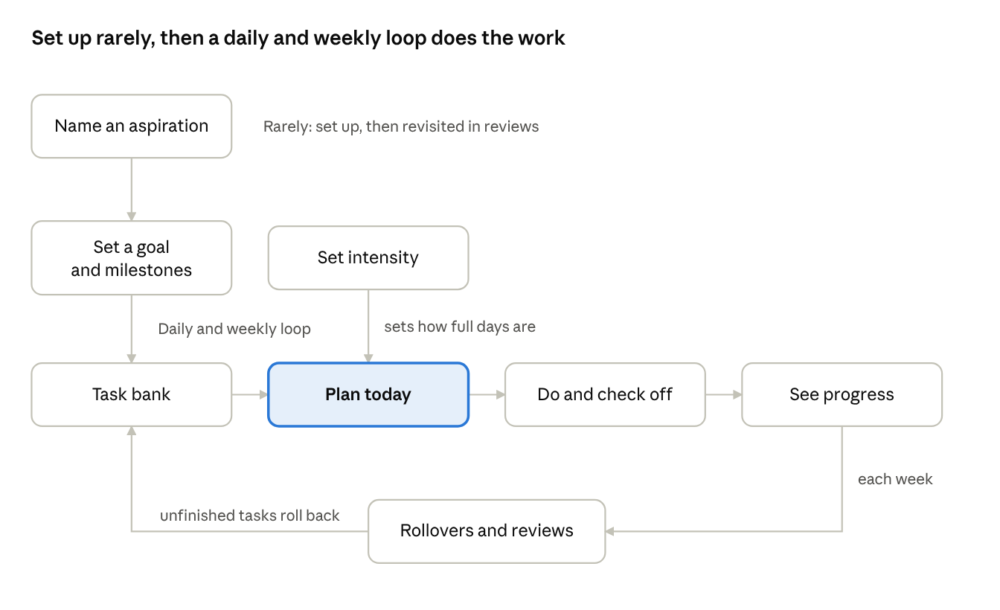

# Screens

Low-fidelity sketches from stage 3 (Nov 2, 2026). They settle layout and behavior, not visual style; hi-fi designs were judged unnecessary for the prototype. Behavior details live in `../flows.md`.

**Behind the data model (Nov 13).** This page describes the click-through as built. The data model pass changed some behavior that the screens don't show yet; where they disagree, `../flows.md` and `../data-model.md` are right. Not yet on screen: a one-off goal's steps as tasks (the goal page still checks them in like milestones), amount targets, the two-choice slipped-deadline card, and delete.

## Today (home screen)

- Three groups: **Keep life running**, **Move forward**, **Free time**. Keep life running holds maintenance and tasks with no goal ("Fill out my ballot"). A recurring item under an aspiration goes in Move forward, with the aspiration as its goal. Free time is the time tasks don't fill, not a list of tasks; it reads "The rest is yours." Timed tasks show "by 7 a.m." or "at 6 p.m." and anchor the order; untimed tasks follow.
- Each goal task shows its goal and aspiration ("Be strong · Be fit"); a recurring item's task under an aspiration shows the aspiration alone ("Be fit"). In **By goal**, each card is titled the same way: an aspiration's own recurring items get a card of their own, after that aspiration's goals. Under each card's title, Keep life running included, a thin bar shows how much of that card is done on the day (bar only, no count). List has no per-group bars.
- Tap a task to mark it done; tap again to undo.
- **Still matter?** A task you added, or a fixed-day item, that has rolled over twice shows a quiet card at the top of Today: the question, the task's title, and **Keep**, **Reschedule** (the day picker) and **Drop**. **Not now** waves it off until tomorrow without answering; ignoring it changes nothing. The card never says how long the task has waited. It shows on Today only, not on other days.
- **A quitting goal's day:** under the tasks, one quiet row per active quitting goal: its label and **Held** / **Slipped**. Once answered, the row shows the answer (tap it for **Held · Slipped · Clear**; Clear also clears the urge) and **Low · Some · Strong** beside it, all optional (tap the chosen level again to clear it). It shows on an empty day too, and on an opened past day, so a missed day can be filled in; a future day offers nothing. It isn't a task: never counted in "1 of 4 done", the cap or the bank, and it never asks.
- Progress for today at the top ("1 of 4 done"). Weekly progress per goal lives on the Week screen.
- The header (heading, "1 of 4 done", progress bar, and "‹ Week" on an opened day) stays pinned while the list scrolls. The List / By goal toggle scrolls away.
- Toggle between **List** (default) and **By goal**. The chosen view is remembered (ADR-004).
- **Pull from bank** adds extra work. Each task's **⋯** menu offers **Back to bank** (skipping, in flows.md) and **Swap** for a bank task, which takes its place in the day. Done tasks have no menu. Swipe gestures may come later.
- **Coming up line** (designed Nov 21, not built): at the bottom, "Coming up: Haircut · Wed at 4:30 p.m. ›", the next thing set to a day or due after today; it opens Coming up. Left out when there's nothing. See "Scheduling and other weeks".

## Week

- Weekly progress per goal ("1 of 3") with a pacing line: "6 days left · on pace", "6 days left · 1 more to plan", or "Done for the week". Nothing else, and never a warning.
- Monday to Sunday. Today highlighted, past days dimmed; an empty day reads "Free day". A day at its cap (3, 4 or 6 tasks, set by intensity) is marked "Full" in muted text, and a day with everything checked off "done" instead. Full is a guide only: nothing is refused, moved or warned about. Tap a day to open it like Today, with every Today action; "‹ Week" goes back. On past days, Pull from bank and Swap are hidden.
- **Other weeks** (designed Nov 21, not built): ‹ › arrows in the header step to any week, back and forward, and replace the This week | Next week toggle below. Each week shows a counts line and fullness bar, and its days get day bars. See "Scheduling and other weeks".
- **Next week:** from 6 p.m. on Sunday a **This week | Next week** toggle appears under the heading, and the choice is remembered. Next week shows its own range, days and bank. Its tasks can be put on a day, sent back to the bank and swapped, but not checked off. The toggle goes once next week has become the current one.
- **Wrap up this week** sits at the bottom of Next week. It opens a sheet that lists what **carries over to next week** and what **ends with this week**, as the API says for each task; an empty list is left out. **Wrap up this week** confirms and makes next week the current one, with no undo; **Not yet** closes the sheet. Nothing prompts it.
- Fixed-day items (trash on Tuesday) stay put: they have no ⋯ menu, but can be checked off.
- **The bank:** this week's tasks not yet on a day, as chips. Tap one, then pick a day (today or later). Drag may come later. Anything placed by hand stays put.
- A tab bar switches screens; the open screen, including an opened day, is remembered. It's **Today | Week | + | Aspirations**: the + (read as "Add" by screen readers, and never marked as the current tab) opens the Add sheet over whatever screen is open.
- The "This week" header and date range stay pinned while the page scrolls.

## Aspirations, Aspiration, Keep life running, Goal detail, Add, Settings

The app is organized aspirations first, matching the model: **Aspirations tab → an aspiration → a goal → its milestones** (decided Nov 10). The Nov 2 sketch below still shows the older "Goals" screen; the Aspirations tab replaces it.

- **Aspirations (tab, replaces Goals):** one card per aspiration in priority order: name, why, a **This week** bar across all its goals ("2 of 5 this week"; sessions only, hours and other amounts come later), its goals with their progress ("Milestone 1 of 6", or "Step 3 of 6" for one-off goals; the goal itself is the final milestone), and its recurring items. Tap the card to open the aspiration; tap a goal row to go straight to Goal detail. Below the cards: **Other goals** (goals with no aspiration, and their past goals collapsed), **Keep life running** (a row that opens its page), and **Retired (n)**, collapsed. The gear for Settings sits in the header; aspirations are added with the + (Add sheet). The footer hint reads "In order of priority. The first comes first when goals compete for time. Add one with +."
- **Aspiration page:** "‹ Aspirations", the name and why, the This week bar, a card per active goal (measurable line, milestone progress, this week's count against its target), **+ Add a goal for Be fit** (Add sheet, Goal tab, aspiration preselected), its recurring items (a paused one reads "Paused"; on an active aspiration, tapping one opens its edit sheet, below) with **+ Add recurring** (Recurring tab, aspiration preselected; neither link shows on a retired aspiration), **Past goals (n)** collapsed, **Priority** ("1st of 3 aspirations") with move up / move down, and **Edit name and why · Retire**. The sketch still shows Review; it was dropped (Nov 10), since its choices repeated these.
- **Keep life running page:** the special case beside the aspirations: what has to happen but rolls up to no goal or aspiration (laundry, the trash, a library book, the insurance). It lists the recurring items with no aspiration and the not-done tasks with no goal, each with where it sits (a day, the bank, a later week, or "Later" while it waits for its week to open). A recurring item opens its edit sheet (below), and a paused one stays listed as "Paused". The tasks only show; checking off and placing happen on Today and Week.
- **Managing aspirations** (all in the click-through): add (Add sheet; a new one goes last in priority), edit the name and why (a sheet), reorder (move up / down on its page), retire and bring back (below).
- **Edit recurring item** is a sheet opened from a recurring row on an active aspiration's page or Keep life running: the Add sheet's Recurring form filled in (name, Fixed day or Flexible with its repeat, the aspiration or none), **Cancel** and **Save** (on once something has changed), then **Pause** or **Resume** below, which act at once. Saving waits for the server; on a failure the sheet stays with what was typed and "Couldn't save that. Try again." After a save the list is read again, so the row shows its new name and repeat or moves to another page; this week's tasks follow the edit (flow 3, step 3). A retired aspiration's items don't open yet.
- **Retire** is a sheet that leads with the aspiration's history ("Since March: 1 goal reached, 3 goals active, 2 recurring items"), then one choice for its active goals and recurring items: **Pause them** (default) or **Keep them going** without an aspiration, under Other goals. The aspiration moves to Retired with its history. **Bring back** (on a retired aspiration's page) makes it active again, last in priority; goals paused by retiring stay paused until resumed one by one.

- **Goal detail:** label, measurable line, aspiration (a link up to its page: "Be fit ›"; back returns wherever you came from), type, Started at / Latest, milestone timeline, weekly target (editable), next check-in with **Check in**, and **Pause · End goal**. Nothing opens unprompted, and there's no Review (dropped Nov 10, as for aspirations). Pausing sets the goal's unfinished tasks aside for the week; resuming returns them to the bank.
  - **A quitting goal** shows its record in place of "Since Nov 3": "12 days held" (with "· 2 not answered" while days in the run have none), then **Recent days**, the last 28 newest first, each Held, Slipped or a dash, with its urge. Tapping a day opens a sheet to answer, change or clear it and rate the urge. An answer shows at once, offline too; the count is the server's and updates once the answer is sent.
  - **Checking in** is a sheet titled with the milestone: "How did it go?", an optional result, **Hit it** / **Not yet** (**Done** for a one-off goal's steps, which can be tapped in any order).
  - **Not yet** shows a quiet card under Next check-in that leads with progress since the baseline, then **Keep the date · Move the date · Adjust the milestone**. Moving a date later, by Move or by Adjust, pushes later milestones out, up to the deadline.
  - **End goal** leads with Started at / Latest and milestones hit, then **I reached it** or **End it for now**. A reached goal reads "Reached Nov 10" and "What's next for Be fit?", counts complete (milestones not checked in read "Passed on the way") and has a quiet **Reopen**; an ended one reads "Not yet." with **Go again**.
  - **The milestone timeline is vertical**, not horizontal as sketched: measurable lines need the full width, and side-swiping fights the iPhone back gesture (decided Nov 10).
  - **Past four milestones it condenses:** the latest hit milestone, any "not yet", Next and the goal always show. Each run of two or more of the rest, Start included, folds into one tappable row ("Start and 1 hit milestone", "2 more: Wk 16, Wk 20"); a single row shows as itself. Tapping a fold or Show all expands the timeline, and Show all / Show less is remembered per goal. This keeps the weekly target and Check in near the top.
- **Add:** one sheet with Task / Goal / Aspiration / Recurring tabs, opened by the + in the tab bar (Task first) or from an aspiration's page. Each tab keeps what was typed while the sheet is open; closing it clears it. Save stays off until the required field is filled. After a task, goal or recurring item saves, the sheet closes and a line above the tab bar says where it went; it clears after 5 s or when tapped. Details in flows 1–3.
  - **Task:** only a title is required; goal, due date and time of day ("by" or "at") are optional. It goes in the bank, or onto today (preselected when the sheet is opened from Today).
  - **Goal:** the type first, then one sentence split at the first colon into label and line, What's this for? (none, an aspiration, or a new one), Where are you now?, a weekly target (building) or start date (quitting), and an optional deadline. Saving opens its page, where milestones are added.
  - **Aspiration:** a name and an optional why. The sheet stays open on "Saved." with **Add a goal for this** and **Done**.
  - **Recurring:** a name, **Fixed day** (a weekday, or the 1st–28th) or **Flexible** (once to 6 times a week, every two weeks, once a month), and an optional aspiration; with none it belongs to Keep life running.
- **Settings:** reached by the gear at the top right of the Aspirations tab; it counts as Aspirations in the tab bar, and "‹ Aspirations" goes back.
  - **Intensity:** Easing off / Normal / Going hard in one row, Normal to start, with "Sets how full days are and how much is free." A tap saves it, with no Save button and no confirmation; it stays until changed, and nothing suggests changing it. A failed save says so, and the choice shown comes back from the API. Week marks a day "Full" once it reaches the cap.
  - **Week starts** Monday and **Notifications** Off are shown, not set. The app asks for no notification permission.
  - **Export my data** answers "Coming later."

## Sign-in

Designed Nov 20 from [ADR-012](../adr/0012-sign-in-with-a-passkey.md) and the brand's logo (stepping stones to a star). Settled with Jan the same day; where the build differs from the sketch, the notes below say so. Sign-in, the code and sign out are built in web-frontend #48; the session-ended sheet, the banner and sign-out's warning in web-frontend #43 (spec 043d).

- **Sign in** (no session on this device): the logo and wordmark, one line ("Small steps today toward who you want to be."), **Sign in with Face ID**, and **New device? Use a one-time code**. A cancelled or failed passkey shows a calm line ("Sign-in didn't finish. Try again when you're ready."); never an error tone.
- **One-time code:** one field (`autocomplete="one-time-code"`) and Continue. A wrong, used or expired code: "That code didn't work. It may already have been used, or be more than ten minutes old. Ask for a new one." No name in the copy.
- **Add a passkey:** "Code accepted", then "Add a passkey to this device" (Face ID from now on; iCloud Keychain carries it to the Mac). Then into the app. The sketch's tester note is left out.
- **Session ended** (a 401 while using the app with anything stored: a week, a screen's last response or a change waiting): not a page. The app keeps showing what the phone has stored, with a sheet: "Sign in to keep saving", then "Everything you did is safe on this phone: 3 changes will send as soon as you're back in." (just "Everything you did is safe on this phone." with none waiting), **Sign in with Face ID** and **Not now**. Not now, Escape or the backdrop leave a small banner above the screen ("Not signed in · 3 changes waiting", and **Sign in**); it sits above the screen rather than under its header as sketched. Changes made meanwhile wait in the queue (ADR-010) and show at once; the sheet doesn't come back on its own. The banner's Sign in opens the sheet with the passkey, so a sign-in that doesn't finish says so there. Once signed in, the queue sends, then the screen reads again. With nothing stored (first sign-in on a phone, or after signing out), a 401 shows the sign-in page.
- **Sign out:** an Account section at the bottom of Settings with Sign out. No "Signed in as": the API has no name for a user. The sheet ("Sign out of this device?") says what's cleared from the phone and that data stays on the server. Sign out sends what's waiting first. If some can't be sent, a warm note says "3 changes haven't been sent yet. Signing out deletes them from this phone." and the button reads **Sign out anyway**; Cancel forgets it, and the next try sends again. Signing out clears the week documents, the screens' last responses and the queue; the open screen and view choices stay (ADR-012).
- Buttons stay the app's #2f6f4f: white on the logo's #1E8A5F falls short of 4.5:1. The wordmark uses the system font.
- **Open:** the final tagline.

## Scheduling and other weeks

Designed with Jan on Nov 21; **not built yet**. The full behavior, rules and suggested work are in [`../briefs/scheduling-and-other-weeks.md`](../briefs/scheduling-and-other-weeks.md).

- **Week, any week:** ‹ › arrows step back to past weeks and forward up to 12 weeks, replacing the This week | Next week toggle (Wrap up this week stays on Next week). Every week shows its counts line and fullness bar, then This week (when not on it) and **Coming up ›**.
- **A week that hasn't opened** shows only what's known: tasks set to a day, fixed-day recurring items, milestone dates and deadlines. "Nothing set yet" on empty days; no Progress, bank or day bars.
- **A past day** can be opened and its unfinished tasks ticked off: "Moved on to the next week · tap if you did it".
- **Add, On a day:** When is **On today · In the bank · On a day**; On a day takes a day and an optional time, and the task stays there.
- **Coming up:** the next 12 weeks, one two-line row each: range, check-in and deadline counts (hollow ring), fullness bar, ▸/▾; then "● 8 for 3 goals · ● 5 upkeep · ● 2 added". The first two weeks open; open weeks list dated things by day, opening their day or goal.
- **Fullness:** counts tasks by origin (goal sessions dark blue, upkeep mid blue, added by hand pale blue). Week bars against a typical week of 25; day bars against the intensity cap, so they agree with "Full". Check-ins and deadlines are never counted. The image says "set" for the third count; the label is "added".

## Core loop

## Screen inventory

Nine screens cover the prototype (Coming up designed, not built), plus Sign-in, shown in place of the app while signed out. Prompts like "still matter?" and "not yet" appear as cards on these screens, not as screens of their own.

| Screen | Used | What it does | Flows |
| --- | --- | --- | --- |
| Today | Daily, the home screen | Today's plan in three groups; check off, swap, skip; pacing | 4, 5 |
| Week | A few times a week | The week's draft by day, plus the bank; move tasks between days and the bank | 3, 4, 7 |
| Coming up | Weekly or less | The next 12 weeks: how full each looks, and what's set, due or checked in | 3, 9 |
| Aspirations | Weekly or less | Aspirations in priority order, each with its week, goals and progress; other goals, Keep life running, retired | 1, 6 |
| Aspiration | Weekly or less | One aspiration: why, this week, its goals, recurring items, past goals; edit, reorder, retire; edit, pause or resume a recurring item | 1, 6, 7 |
| Keep life running | Rarely | Recurring items and tasks that belong to no goal or aspiration; a recurring item opens to edit, pause or resume | 3, 7 |
| Goal detail | Weekly or less | Label, measurable line, baseline, milestones, weekly target, progress, check-ins | 2, 6, 7 |
| Add | Rarely | One sheet with a tab each for a task, goal (type first, one sentence), aspiration or recurring item | 1, 2, 3 |
| Settings | Rarely | Intensity (which sets how much free time is protected); week start, notifications and export shown for later | 8 |
