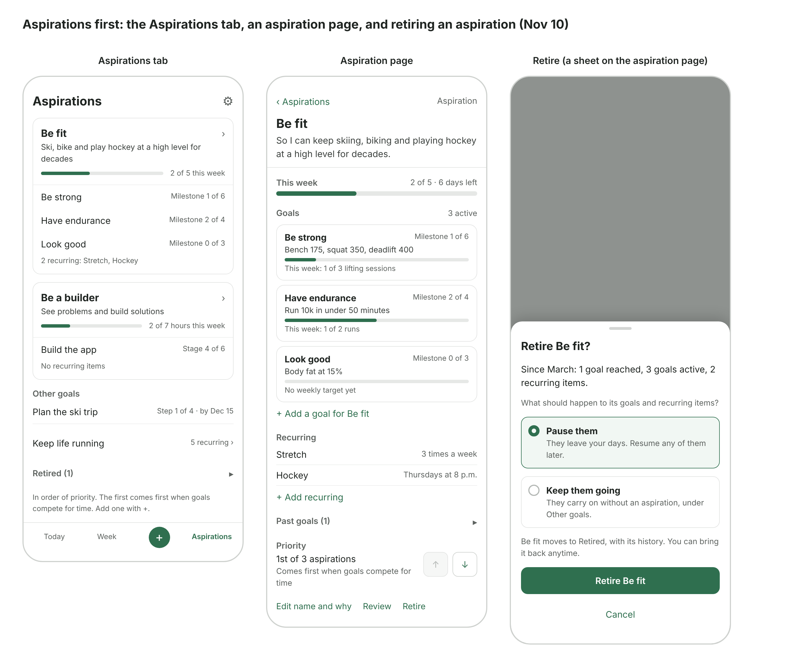
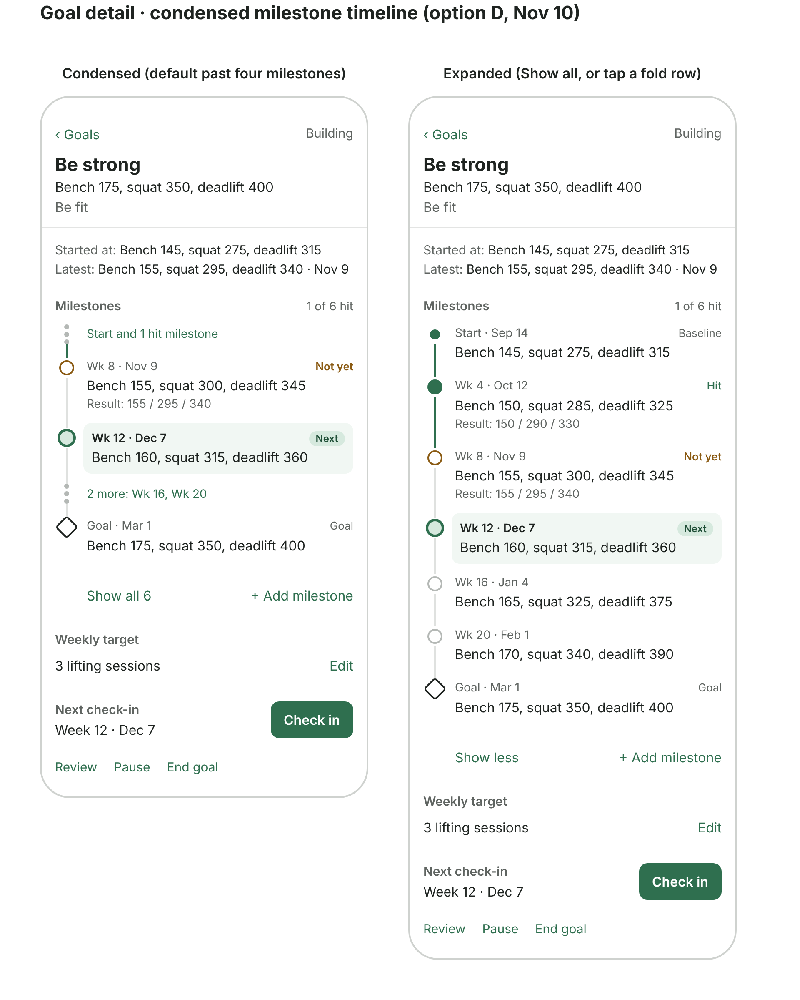

# Screens

Low-fidelity sketches from stage 3 (Nov 2, 2026). They settle layout and behavior, not visual style; hi-fi designs were judged unnecessary for the prototype. Behavior details live in `../flows.md`.

## Today (home screen)

- Three groups: **Keep life running**, **Move forward**, **Free time**. Keep life running holds maintenance and tasks with no goal ("Fill out my ballot"). Free time is the time tasks don't fill, not a list of tasks; it reads "The rest is yours." Timed tasks show "by 7 a.m." or "at 6 p.m." and anchor the order; untimed tasks follow.
- Each goal task shows its goal and aspiration ("Be strong · Be fit"). In **By goal**, each card is titled the same way.
- Tap a task to mark it done; tap again to undo.
- Progress for today at the top ("1 of 4 done"). Weekly progress per goal lives on the Week screen.
- The header (heading, "1 of 4 done", progress bar, and "‹ Week" on an opened day) stays pinned while the list scrolls. The List / By goal toggle scrolls away.
- Toggle between **List** (default) and **By goal**. The chosen view is remembered (ADR-004).
- **Pull from bank** adds extra work. Each task's **⋯** menu offers **Back to bank** (skipping, in flows.md) and **Swap** for a bank task, which takes its place in the day. Done tasks have no menu. Swipe gestures may come later.

## Week

- Weekly progress per goal ("1 of 3") with a pacing line: "6 days left · on pace", "6 days left · 1 more to plan", or "Done for the week". Nothing else, and never a warning.
- Monday to Sunday. Today highlighted, past days dimmed; an empty day reads "Free day". Tap a day to open it like Today, with every Today action; "‹ Week" goes back. On past days, Pull from bank and Swap are hidden.
- Fixed-day items (trash on Tuesday) stay put: they have no ⋯ menu, but can be checked off.
- **The bank:** this week's tasks not yet on a day, as chips. Tap one, then pick a day (today or later). Drag may come later. Anything placed by hand stays put.
- A tab bar switches screens; the open screen, including an opened day, is remembered. It's **Today | Week | + | Aspirations**: the + (read as "Add" by screen readers, and never marked as the current tab) opens the Add sheet over whatever screen is open.
- The "This week" header and date range stay pinned while the page scrolls.

## Aspirations, Aspiration, Keep life running, Goal detail, Add, Settings

The app is organized aspirations first, matching the model: **Aspirations tab → an aspiration → a goal → its milestones** (decided Nov 10). The Nov 2 sketch below still shows the older "Goals" screen; the Aspirations tab replaces it.

- **Aspirations (tab, replaces Goals):** one card per aspiration in priority order: name, why, a **This week** bar across all its goals ("2 of 5 this week"; sessions only, hours and other amounts come later), its goals with their progress ("Milestone 1 of 6", or "Step 3 of 6" for one-off goals; the goal itself is the final milestone), and its recurring items. Tap the card to open the aspiration; tap a goal row to go straight to Goal detail. Below the cards: **Other goals** (goals with no aspiration, and their past goals collapsed), **Keep life running** (a row that opens its page), and **Retired (n)**, collapsed. The gear for Settings sits in the header; aspirations are added with the + (Add sheet). The footer hint reads "In order of priority. The first comes first when goals compete for time. Add one with +."
- **Aspiration page:** "‹ Aspirations", the name and why, the This week bar, a card per active goal (measurable line, milestone progress, this week's count against its target), **+ Add a goal for Be fit** (Add sheet, Goal tab, aspiration preselected), its recurring items with **+ Add recurring** (Recurring tab, aspiration preselected; neither link shows on a retired aspiration), **Past goals (n)** collapsed, **Priority** ("1st of 3 aspirations") with move up / move down, and **Edit name and why · Retire**. The sketch still shows Review; it was dropped (Nov 10), since its choices repeated these.
- **Keep life running page:** the special case beside the aspirations: what has to happen but rolls up to no goal or aspiration (laundry, the trash, a library book, the insurance). It lists the recurring items with no aspiration and the not-done tasks with no goal, each with where it sits (a day, the bank or a later week). It only shows; checking off and placing happen on Today and Week.
- **Managing aspirations** (all in the click-through): add (Add sheet; a new one goes last in priority), edit the name and why (a sheet), reorder (move up / down on its page), retire and bring back (below).
- **Retire** is a sheet that leads with the aspiration's history ("Since March: 1 goal reached, 3 goals active, 2 recurring items"), then one choice for its active goals and recurring items: **Pause them** (default) or **Keep them going** without an aspiration, under Other goals. The aspiration moves to Retired with its history. **Bring back** (on a retired aspiration's page) makes it active again, last in priority; goals paused by retiring stay paused until resumed one by one.

- **Goal detail:** label, measurable line, aspiration (a link up to its page: "Be fit ›"; back returns wherever you came from), type, Started at / Latest, milestone timeline, weekly target (editable), next check-in with **Check in**, and **Pause · End goal**. Nothing opens unprompted, and there's no Review (dropped Nov 10, as for aspirations). Pausing sets the goal's unfinished tasks aside for the week; resuming returns them to the bank.
  - **Checking in** is a sheet titled with the milestone: "How did it go?", an optional result, **Hit it** / **Not yet** (**Done** for a one-off goal's steps, which can be tapped in any order).
  - **Not yet** shows a quiet card under Next check-in that leads with progress since the baseline, then **Keep the date · Move the date · Adjust the milestone**. Moving a date later pushes later milestones out, up to the deadline.
  - **End goal** leads with Started at / Latest and milestones hit, then **I reached it** or **End it for now**. A reached goal reads "Reached Nov 10" and "What's next for Be fit?", counts complete (milestones not checked in read "Passed on the way") and has a quiet **Reopen**; an ended one reads "Not yet." with **Go again**.
  - **The milestone timeline is vertical**, not horizontal as sketched: measurable lines need the full width, and side-swiping fights the iPhone back gesture (decided Nov 10).
  - **Past four milestones it condenses:** the latest hit milestone, any "not yet", Next and the goal always show. Each run of two or more of the rest, Start included, folds into one tappable row ("Start and 1 hit milestone", "2 more: Wk 16, Wk 20"); a single row shows as itself. Tapping a fold or Show all expands the timeline, and Show all / Show less is remembered per goal. This keeps the weekly target and Check in near the top.
- **Add:** one sheet with Task / Goal / Aspiration / Recurring tabs, opened by the + in the tab bar (Task first) or from an aspiration's page. Each tab keeps what was typed while the sheet is open; closing it clears it. Save stays off until the required field is filled. After a task, goal or recurring item saves, the sheet closes and a line above the tab bar says where it went; it clears after 5 s or when tapped. Details in flows 1–3.
  - **Task:** only a title is required; goal, due date and time of day ("by" or "at") are optional. It goes in the bank, or onto today (preselected when the sheet is opened from Today).
  - **Goal:** the type first, then one sentence split at the first colon into label and line, What's this for? (none, an aspiration, or a new one), Where are you now?, a weekly target (building) or start date (quitting), and an optional deadline. Saving opens its page, where milestones are added.
  - **Aspiration:** a name and an optional why. The sheet stays open on "Saved." with **Add a goal for this** and **Done**.
  - **Recurring:** a name, **Fixed day** (a weekday, or the 1st–28th) or **Flexible** (once to 6 times a week, every two weeks, once a month), and an optional aspiration; with none it belongs to Keep life running.
- **Settings:** reached by the gear at the top right of the Aspirations tab; it counts as Aspirations in the tab bar, and "‹ Aspirations" goes back.
  - **Intensity:** Easing off / Normal / Going hard in one row, Normal to start, with "Sets how full days are and how much is free." A tap saves it, with no Save button and no confirmation; it stays until changed, and nothing suggests changing it. A failed save puts back the earlier choice. Nothing reads it yet; the planner will.
  - **Week starts** Monday and **Notifications** Off are shown, not set. The app asks for no notification permission.
  - **Export my data** answers "Coming later."

## Core loop

## Screen inventory

Eight screens cover the prototype. Prompts like "still matter?" and "not yet" appear as cards on these screens, not as screens of their own.

| Screen | Used | What it does | Flows |
| --- | --- | --- | --- |
| Today | Daily, the home screen | Today's plan in three groups; check off, swap, skip; pacing | 4, 5 |
| Week | A few times a week | The week's draft by day, plus the bank; move tasks between days and the bank | 3, 4, 7 |
| Aspirations | Weekly or less | Aspirations in priority order, each with its week, goals and progress; other goals, Keep life running, retired | 1, 6 |
| Aspiration | Weekly or less | One aspiration: why, this week, its goals, recurring items, past goals; edit, reorder, retire | 1, 6 |
| Keep life running | Rarely | Recurring items and tasks that belong to no goal or aspiration; show-only | 3 |
| Goal detail | Weekly or less | Label, measurable line, baseline, milestones, weekly target, progress, check-ins | 2, 6, 7 |
| Add | Rarely | One sheet with a tab each for a task, goal (type first, one sentence), aspiration or recurring item | 1, 2, 3 |
| Settings | Rarely | Intensity (which sets how much free time is protected); week start, notifications and export shown for later | 8 |
